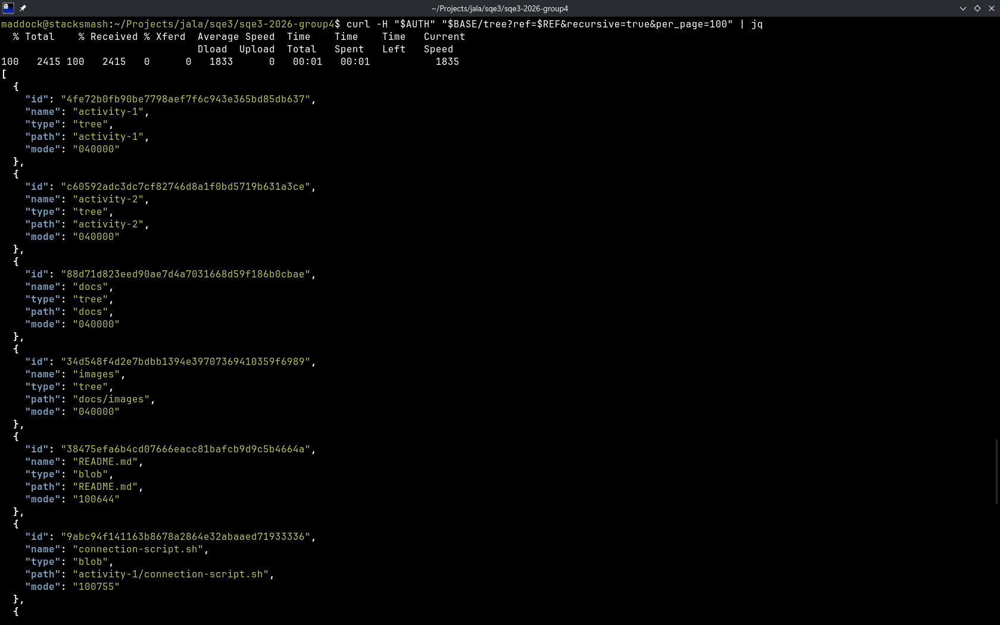
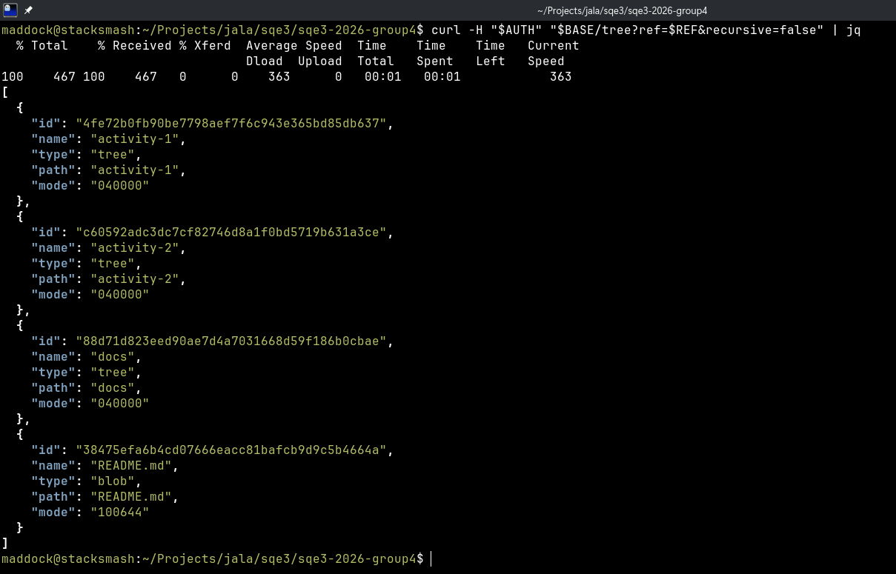
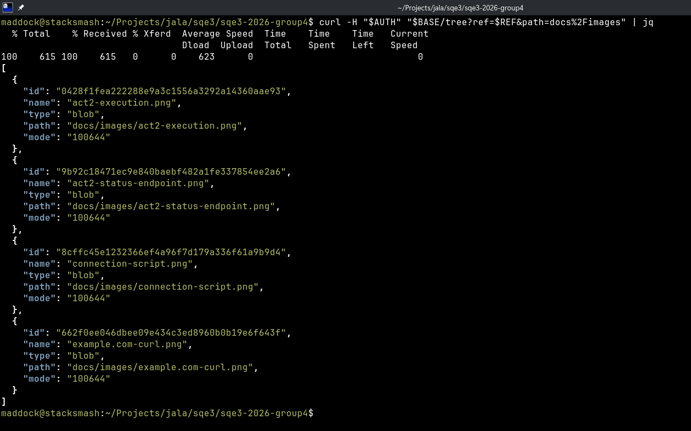
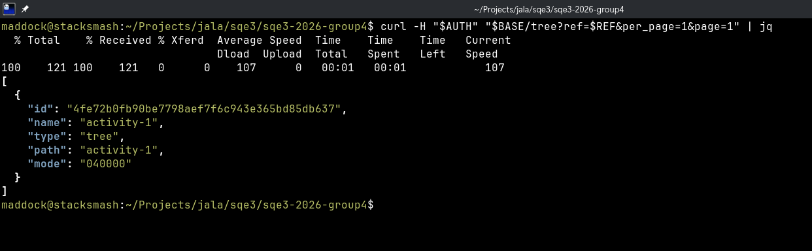
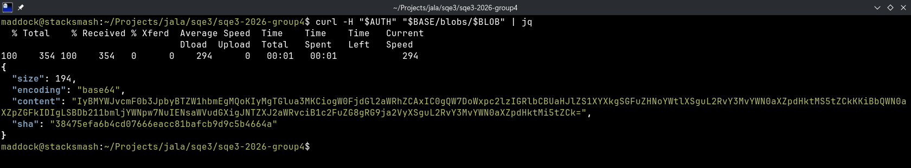
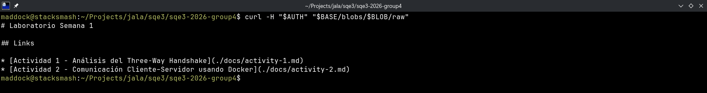
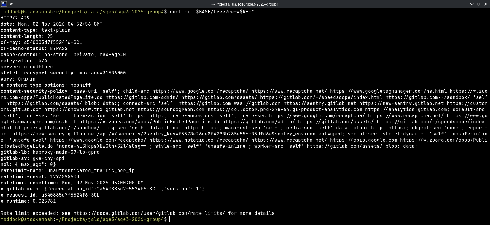
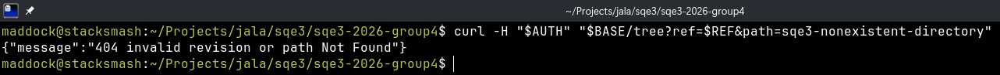
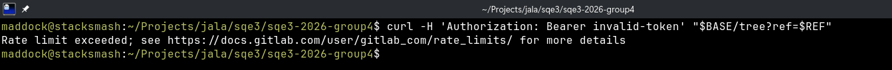

# Lab 1 — Maddock: Repositories

[← Back to the group lab](l1.md)

**Feature:** [Repositories API](https://docs.gitlab.com/api/repositories/).

## Contents

- [Activity 2: Research and exploratory testing](#actividad-2)
  - [Feature description](#21-feature-description)
  - [Feature setup](#22-feature-setup)
  - [Exploratory testing](#23-exploratory-testing)
- [Activity 3: Use case](#actividad-3)
  - [Use case description](#31-use-case-description)
- [Activity 4: Acceptance criteria and test cases](#actividad-4)
  - [Acceptance criteria](#41-acceptance-criteria)
  - [Prompt and procedure](#42-prompt-and-procedure)
  - [Low-level test cases](#43-low-level-test-cases-lltc)
- [Activity 5: Test classification](#actividad-5)
  - [Classification and prioritization](#51-proposed-classification-and-prioritization)
- [Feature sources](#fuentes)

## Activity #2: Research and exploratory testing

### 2.1 Feature description

The Repositories API lets users browse repository entries and read file contents. This report tests tree listings and blob retrieval using an existing project.

| Method | Endpoint relative to `/api/v4` | Purpose |
| --- | --- | --- |
| GET | `/projects/:id/repository/tree` | List repository entries at a path and revision. |
| GET | `/projects/:id/repository/blobs/:sha` | Retrieve blob metadata and Base64-encoded content. |
| GET | `/projects/:id/repository/blobs/:sha/raw` | Retrieve the blob's raw bytes. |

Each tree entry has an `id` and a `type`: `blob` for files or `tree` for directories. Listings can be filtered by revision and path, expanded recursively, and paginated. A commit SHA selects a repository revision, while a blob SHA identifies file content. All operations in this report are read-only.

### 2.2 Feature setup

Follow the [shared authentication and setup instructions](l1.md#autenticacion) with the public project [computer-networks-2-lab-week-1](https://gitlab.com/notmaddock/computer-networks-2-lab-week-1). The tests use a commit pinned from `master` so that results remain comparable.

| Variable | Use |
| --- | --- |
| `project_id` | `86160682`, the public test project. |
| `access_token` | GitLab PAT (personal access token) |
| `ref` | `bee3de554beadc2569fc232da1b807d2f0d47d72`, pinned from `master`. |
| `readme_blob_sha` | `38475efa6b4cd07666eacc81bafcb9d9c5b4664a`, the `README.md` blob. |
| `private_project_id` | Private project readable by the token. Use a commit from that project as `private_ref` for the access-control case. |
| `missing_ref` | Unique branch name `sqe3-missing-{{run_id}}`, confirmed absent. |
| `missing_path` | Unique directory `sqe3-absent-{{run_id}}`, confirmed absent at `ref`. |
| `missing_blob_sha` | A 40-character hexadecimal ID that does not identify an available blob. |

#### Shell variables used in the screenshots

| Variable | Value | Purpose |
| --- | --- | --- |
| `BASE` | `https://gitlab.com/api/v4/projects/86160682/repository` | Base URL for repository requests. Includes `project_id`. |
| `REF` | `bee3de554beadc2569fc232da1b807d2f0d47d72` | Pinned commit SHA, corresponding to `ref`. |
| `BLOB` | `38475efa6b4cd07666eacc81bafcb9d9c5b4664a` | README blob SHA, corresponding to `readme_blob_sha`. |
| `AUTH` | `Authorization: Bearer <access_token>` | Used with `curl -H "$AUTH"`. The token value is kept secret. |

Authenticated requests use `AUTH`. Omit it for anonymous requests or use `Authorization: Bearer invalid-token-sqe3` to test an invalid token.

At the pinned revision, the project contains `README.md`, `docs/activity-1.md` and the `docs/images` directory. Save the initial listings to compare later responses. For content checks, compare the decoded Base64 with the raw download and check its byte length. Verify the blob ID by computing SHA-1 over `blob <byte-length>`, a NUL byte, and the content.

Prepare each case separately and follow all result pages when comparing listings.

### 2.3 Exploratory testing

| Operation | Observed result |
| --- | --- |
| Root and recursive tree listing | `200`. Entries include paths, Git object IDs and object types. |
| Directory listing with `path=docs` and `path=docs%2Fimages` | `200`. Entries belong to the selected directory. |
| Pagination with `per_page=1` | Four distinct root entries across four pages, followed by an empty page. The combined entries match the root listing. |
| Missing repository path or revision | `404`. |
| README blob JSON and raw retrieval | `200`. Decoded Base64 equals raw content, byte size matches, and the computed Git blob hash matches the tree entry. |
| Missing blob JSON and raw retrieval | `404`. |
| Repeated recursive listing at the pinned revision | The path and object-ID pairs remain consistent. |

#### Repository trees

#### Blob content

#### Access and missing resources

## Activity #3: Use case

### 3.1 Use case description

**User story:** As a QA engineer with repository read access, I want to browse a fixed repository revision and read its files so that I can verify the delivered documentation without changing it.

**Use case:** Browse and read documentation at a pinned commit.

**Actor:** Project member or anonymous reader of the public project.

**Preconditions:** The project is accessible and the [test variables](#22-feature-setup) are configured.

| Step | Interaction | Proposed check |
| --- | --- | --- |
| 1 | List root entries at `ref`. | Root files and `docs` directory are identified. |
| 2 | List nested entries recursively at the same `ref`. | Confirm nested documentation entries. Save the root README blob SHA. |
| 3 | Retrieve blob JSON. | Decode Base64 and retain the decoded bytes for the next step. |
| 4 | Retrieve raw blob content. | Raw bytes match decoded JSON, and their computed Git blob ID matches the pinned tree. |
| 5 | Read the tree again at `ref`. | Paths and object IDs remain unchanged. |

**Expected result:** JSON and raw responses contain the same file content and match its blob ID. The repository stays unchanged.

**Alternative flows:** Missing credentials, invalid token, nonexistent ref/path/blob, path encoding, pagination, recursive traversal and public anonymous reads.

## Activity #4: Acceptance criteria and test cases

### 4.1 Acceptance criteria

The criteria follow the [Repositories API](https://docs.gitlab.com/api/repositories/) and [shared authentication conventions](l1.md#autenticacion).

- **CA-REPO-01:** Root listing returns `200` and the expected root entries.
- **CA-REPO-02:** Recursive listing includes nested files.
- **CA-REPO-03:** A directory path restricts returned entries to that directory.
- **CA-REPO-04:** A once-encoded nested query path resolves the intended directory.
- **CA-REPO-05:** Pagination with `per_page=1` returns at most one entry per page without losing entries.
- **CA-REPO-06:** An absent revision does not return a successful repository tree.
- **CA-REPO-07:** A missing directory at the pinned ref returns `404` on GitLab 17.7+.
- **CA-REPO-08:** Blob JSON returns correct SHA, byte size, Base64 encoding and content.
- **CA-REPO-09:** Raw content matches the README blob ID.
- **CA-REPO-10:** A public repository can be read without authentication.
- **CA-REPO-11:** JSON retrieval of an unavailable blob returns `404`.
- **CA-REPO-12:** Raw retrieval of an unavailable blob returns `404`.
- **CA-REPO-13:** Unauthenticated requests cannot disclose the private repository tree.
- **CA-REPO-14:** An explicitly invalid token is rejected with `401`.
- **CA-REPO-15:** Tree, encoded blob and raw content remain consistent throughout a read-only flow.

### 4.2 Prompt and procedure

**Prompt to generate the initial scenario list:**

> Using the official GitLab Repositories API documentation at https://docs.gitlab.com/api/repositories/, propose positive, negative, boundary, authentication and E2E scenarios for repository tree listing and blob JSON/raw retrieval. Cover pinned revisions, path encoding, shallow versus recursive traversal, pagination, missing resources, private-project access and existing repository fixtures. Include titles and brief checks. Do not invent write endpoints, limits, error messages or undocumented status codes. Treat setup separately from operations under test.

**Procedure:** Review the suggested scenarios against the documentation, remove duplicates and develop the selected cases below. Link each case to an acceptance criterion and record its result when executed.

### 4.3 Low-level test cases (LLTC)

**Preparation:** The [feature setup](#22-feature-setup) applies to all cases. Paths below start at `{{base_url}}`. Use Bearer authentication unless the case says otherwise. These GET requests need no body. Find blob IDs in the tree at `ref` and follow all pages when comparing listings.

**Test data:** Use the project and variables from the [feature setup](#22-feature-setup). For missing-resource tests, confirm the chosen names or IDs do not exist. Measure content size in bytes.

**Cleanup:** No resources are created. Restore valid credentials after authentication tests.

**Status:** 15 designed test cases.

#### TC_REPO_GET_001 — List root entries at a pinned revision

**Criterion:** CA-REPO-01 
**Type:** Positive functional 
**Priority:** P1

| Step | Request or action | Expected result |
| --- | --- | --- |
| 1 | GET `/projects/{{project_id}}/repository/tree?ref={{ref}}&recursive=false` and collect every page. | HTTP `200`. Entries include `README.md`, `docs`. |
| 2 | Inspect each entry. | `README.md` has `type=blob`. `docs` has `type=tree`. All entries have object IDs. Nested file paths are absent. |

#### TC_REPO_GET_002 — List all nested entries recursively

**Criterion:** CA-REPO-02 
**Type:** Positive functional 
**Priority:** P1

| Step | Request or action | Expected result |
| --- | --- | --- |
| 1 | GET `/projects/{{project_id}}/repository/tree?ref={{ref}}&recursive=true`. Follow every page. | HTTP `200`. Includes `docs/activity-1.md` and entries under `docs/images`. |
| 2 | Save the ID for `README.md`. | The README entry has `type=blob`. Its ID matches `readme_blob_sha`. |

#### TC_REPO_GET_003 — Restrict listing to a directory

**Criterion:** CA-REPO-03 
**Type:** Positive functional 
**Priority:** P1

| Step | Request or action | Expected result |
| --- | --- | --- |
| 1 | GET `/projects/{{project_id}}/repository/tree?ref={{ref}}&path=docs&recursive=false`. Collect every page. | HTTP `200`. Includes `docs/activity-1.md` and `docs/images`. Root files and deeper descendants are excluded. |

#### TC_REPO_GET_004 — Resolve an encoded nested path

**Criterion:** CA-REPO-04 
**Type:** Positive functional 
**Priority:** P2

**Preconditions:** Save a recursive listing at `ref` for comparison. Encode `docs/images` once as `docs%2Fimages`.

| Step | Request or action | Expected result |
| --- | --- | --- |
| 1 | GET `/projects/{{project_id}}/repository/tree?ref={{ref}}&path=docs%2Fimages&recursive=false`. | HTTP `200`. Only direct children of `docs/images` appear, matching the saved listing. |

#### TC_REPO_GET_005 — Traverse one-entry tree pages

**Criterion:** CA-REPO-05 
**Type:** Boundary 
**Priority:** P2

**Preconditions:** Save the full root listing at `ref` for comparison.

| Step | Request or action | Expected result |
| --- | --- | --- |
| 1 | GET `/projects/{{project_id}}/repository/tree?ref={{ref}}&per_page=1&page=1`. | HTTP `200`. One entry is returned. |
| 2 | Follow available next-page links or page headers until exhausted, preserving `ref` and `per_page=1`. | Each page contains at most one entry. Together, the pages match the saved listing without duplicates. |

#### TC_REPO_GET_006 — Reject a nonexistent revision

**Criterion:** CA-REPO-06 
**Type:** Negative functional 
**Priority:** P2

**Preconditions:** `missing_ref` confirmed absent. Valid credentials.

| Step | Request or action | Expected result |
| --- | --- | --- |
| 1 | GET `/projects/{{project_id}}/repository/tree?ref={{missing_ref}}`. | HTTP `404`. An error is returned instead of a tree. |
| 2 | Read root tree at valid `ref`. | HTTP `200`. The project is still readable. |

#### TC_REPO_GET_007 — Reject a nonexistent tree path

**Criterion:** CA-REPO-07 
**Type:** Negative functional 
**Priority:** P2

**Preconditions:** `missing_path` absent. Target GitLab 17.7+ (older versions require a separate expected result).

| Step | Request or action | Expected result |
| --- | --- | --- |
| 1 | GET `/projects/{{project_id}}/repository/tree?ref={{ref}}&path={{missing_path}}`. | HTTP `404`. An error is returned instead of an empty directory listing. |
| 2 | Read root tree at `ref`. | HTTP `200`. The entries are unchanged. |

#### TC_REPO_GET_008 — Retrieve blob metadata and encoded content

**Criterion:** CA-REPO-08 
**Type:** Positive functional 
**Priority:** P1

**Preconditions:** Find the README blob ID in the tree at `ref`.

| Step | Request or action | Expected result |
| --- | --- | --- |
| 1 | GET `/projects/{{project_id}}/repository/blobs/{{readme_blob_sha}}`. | HTTP `200`. `sha` matches saved blob ID and `encoding` is `base64`. |
| 2 | Decode `content` as Base64 and compute its Git blob hash. | The recomputed Git blob hash matches the pinned ID. `size` equals its byte length, including all line endings. |

#### TC_REPO_GET_009 — Retrieve raw UTF-8 blob bytes

**Criterion:** CA-REPO-09 
**Type:** Positive functional 
**Priority:** P1

**Preconditions:** Find the README blob ID in the tree at `ref`.

| Step | Request or action | Expected result |
| --- | --- | --- |
| 1 | GET `/projects/{{project_id}}/repository/blobs/{{readme_blob_sha}}/raw`. Retain raw response bytes. | HTTP `200`. The raw bytes produce `readme_blob_sha`, without a JSON or Base64 wrapper. |

#### TC_REPO_GET_010 — Read a public tree without credentials

**Criterion:** CA-REPO-10 
**Type:** Positive functional 
**Priority:** P2

**Preconditions:** Confirm the project is public. Save an authenticated root listing at `ref`, then remove all credentials.

| Step | Request or action | Expected result |
| --- | --- | --- |
| 1 | GET `/projects/{{project_id}}/repository/tree?ref={{ref}}` without credentials. Collect all pages. | HTTP `200`. Public repository entries are returned. |
| 2 | Compare path/object-ID pairs with the authenticated baseline at the same ref. | Same tree entries. Anonymous access does not change repository content. |

**Cleanup:** Restore the configured valid credentials.

#### TC_REPO_GET_011 — Reject an unavailable blob ID

**Criterion:** CA-REPO-11 
**Type:** Negative functional 
**Priority:** P2

**Preconditions:** `missing_blob_sha` confirmed unavailable. Valid credentials.

| Step | Request or action | Expected result |
| --- | --- | --- |
| 1 | GET `/projects/{{project_id}}/repository/blobs/{{missing_blob_sha}}`. | HTTP `404`. No blob content returned. |
| 2 | Retrieve known README blob. | HTTP `200`. The README is still readable. |

#### TC_REPO_GET_012 — Reject raw retrieval of an unavailable blob

**Criterion:** CA-REPO-12 
**Type:** Negative functional 
**Priority:** P2

**Preconditions:** `missing_blob_sha` confirmed unavailable. Valid credentials.

| Step | Request or action | Expected result |
| --- | --- | --- |
| 1 | GET `/projects/{{project_id}}/repository/blobs/{{missing_blob_sha}}/raw`. | HTTP `404`. Response is an error, not successful file content. |

#### TC_REPO_GET_013 — Protect private repository reads without credentials

**Criterion:** CA-REPO-13 
**Type:** Negative authorization 
**Priority:** P1

**Preconditions:** Use a populated private project and a valid `private_ref`. Start without credentials.

| Step | Request or action | Expected result |
| --- | --- | --- |
| 1 | GET `/projects/{{private_project_id}}/repository/tree?ref={{private_ref}}` without credentials. | Access rejected. Record actual status (`404` may conceal the private project). No repository entries are returned. |
| 2 | Repeat using valid token. | HTTP `200`. Repository entries are returned with valid credentials. |

#### TC_REPO_GET_014 — Reject an invalid token

**Criterion:** CA-REPO-14 
**Type:** Negative authentication 
**Priority:** P1

**Preconditions:** Use the public project and the invalid token below.

| Step | Request or action | Expected result |
| --- | --- | --- |
| 1 | GET `/projects/{{project_id}}/repository/tree?ref={{ref}}` with `Authorization: Bearer invalid-token-sqe3`. | HTTP `401`. No repository tree disclosed. |
| 2 | Restore valid token and repeat. | HTTP `200`. The expected entries are returned. |

#### TC_REPO_E2E_001 — Browse and read the same immutable file

**Criterion:** CA-REPO-15 
**Type:** E2E 
**Priority:** P0

**Preconditions:** Use the commit from the [feature setup](#22-feature-setup) and find the README blob ID within this case.

| Step | Request or action | Expected result |
| --- | --- | --- |
| 1 | List full root and recursive trees at `ref`. Save pairs separately as `root_baseline` and `recursive_baseline`, and save README blob ID. | HTTP `200`. Root entries, nested files and the README blob ID are available. |
| 2 | GET README blob JSON. Decode content. | HTTP `200`. SHA matches the saved ID. Decoded content is retained for raw comparison. |
| 3 | GET raw README blob. | HTTP `200`. Bytes equal decoded JSON. Compute the Git blob hash and compare it with the saved README ID. |
| 4 | Repeat full recursive tree at identical `ref`. | HTTP `200`. Path/object-ID pairs equal `recursive_baseline`. The pinned revision remains consistent. |

## Activity #5: Test classification

### 5.1 Proposed classification and prioritization

| Type | Cases | Purpose |
| --- | --- | --- |
| Positive functional | `TC_REPO_GET_001`–`004`, `008`–`010` | Tree navigation and correct content retrieval. |
| Negative functional | `TC_REPO_GET_006`–`007`, `011`–`012` | Absent revisions, paths and blobs. |
| Authentication / authorization | `TC_REPO_GET_013`–`014` | Protect private content and reject invalid tokens. |
| Boundary | `TC_REPO_GET_005` | One-entry pages. |
| E2E | `TC_REPO_E2E_001` | Complete browse/read consistency at an immutable revision. |

P0 covers the main browse/read flow. P1 covers essential reads and access control. P2 covers query options, missing resources and boundaries. The group document collects the shared [priorities](l1.md#actividad-5), [API testing conventions](l1.md#convenciones), and [feedback](l1.md#retroalimentacion).

## Feature sources

- [GitLab Repositories API](https://docs.gitlab.com/api/repositories/).
- [GitLab REST authentication](https://docs.gitlab.com/api/rest/authentication/).
- [GitLab REST pagination](https://docs.gitlab.com/api/rest/#pagination).
- [Shared lab sources](l1.md#fuentes).

[← Back to the group lab](l1.md)
