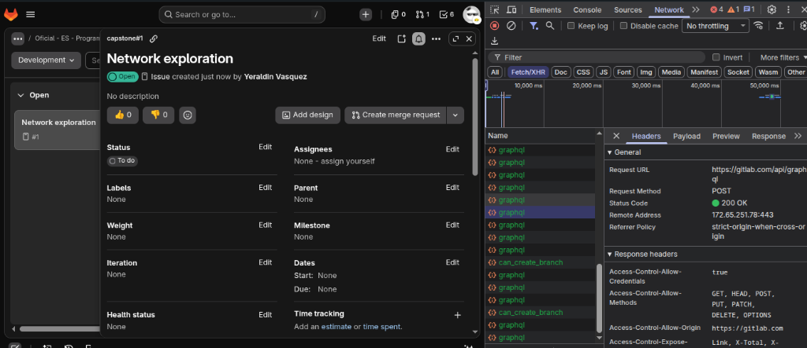
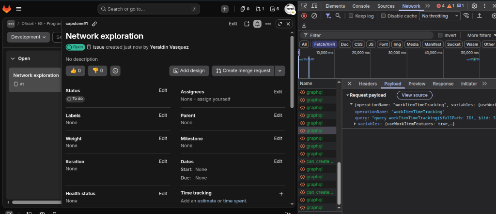

# Lab 1 — Yeraldin: Project issues

[← Back to the group lab](l1.md)

I will test how project issues are created, retrieved, updated, filtered and deleted.

## Contents

- [Activity 2: Issues research and exploration](#actividad-2)
- [Activity 3: Use case](#actividad-3)
- [Activity 4: Criteria and LLTC cases](#actividad-4)
- [Activity 5: Test classification](#actividad-5)
- [Feature sources](#fuentes)

---

<a id="actividad-2"></a>

## Activity #2: Research and exploratory testing

### 2.1 Feature description

Project issues in GitLab enable team members to track defect reports, enhancements and backlog tasks directly within a project repository. Creating, editing and closing issues requires at least the Reporter role in private projects, while deleting an issue requires Project Owner or Administrator permissions (or the issue author where permitted). Reference: [GitLab Issues API — Delete an issue](https://docs.gitlab.com/api/issues/#delete-an-issue).

The tests follow this sequence:

| Step | Method | Endpoint relative to `/api/v4` | Purpose |
| --- | --- | --- | --- |
| 1 | POST | `/projects/:id/issues` | Create a defect report. |
| 2 | GET | `/projects/:id/issues/:issue_iid` | Retrieve issue details by project-scoped internal ID (`iid`). |
| 3 | PUT | `/projects/:id/issues/:issue_iid` | Update description, assign labels or change state. |
| 4 | GET | `/projects/:id/issues?state=closed` | List and filter issues by state or labels. |
| 5 | DELETE | `/projects/:id/issues/:issue_iid` | Delete the issue. |

The API requires `title` when creating an issue. Optional fields include `description`, `labels`, `milestone_id` and `assignee_ids`. Issue modifications accept partial updates. For closing or reopening an issue, the `state_event` parameter is used with values `close` or `reopen`. In all project-scoped routes, `:issue_iid` refers to the internal project issue number (`iid`), not the global database ID. Reference: [GitLab Issues documentation](https://docs.gitlab.com/user/project/issues/).

### 2.2 Feature setup

I start with the [group authentication](l1.md#autenticacion). For these cases I use a private project with Issues enabled and the following additional variables:

| Variable | Use in Issues tests |
| --- | --- |
| `token_reporter` | Token with `api` scope belonging to a Reporter or higher. Used as `access_token` when creating, retrieving, editing and closing issues. |
| `token_owner` | Token with `api` scope belonging to a Project Owner. Required when executing issue deletion requests and cleanup. |
| `token_guest` | Token belonging to a Guest user with read-only permissions in the project. Used to check authorization restrictions. |
| `issue_iid` | Internal issue number returned by the API (`iid`), used in subsequent path parameters. |

The remaining variables are in the group document.

### 2.3 Exploratory testing

During exploratory testing in the browser using Chrome DevTools (Network tab filtered by `Fetch/XHR`), I inspected the background HTTP interactions triggered by the GitLab web UI when viewing an issue.

| Action | Target & Interaction | Observed behavior | Evidence |
| --- | --- | --- | --- |
| Inspect & Query | Inspected created issue `Network exploration` (`#1`) in project `capstone#1`. | Web UI triggers background GraphQL queries including `workItemTimeTracking` via `POST https://gitlab.com/api/graphql` returning `200 OK`. | Headers inspection screenshot. |
| Payload verification | Inspected GraphQL payload for the time-tracking query. | Client sends query `workItemTimeTracking` parameterized with project full path and `iid: "1"`. | Payload inspection screenshot. |

#### Recorded Network Evidence

**1. Request Headers and Status:**



*Figure 2.1: DevTools Network inspection showing `POST https://gitlab.com/api/graphql` with status `200 OK` triggered when inspecting issue #1 details in the browser.*

**2. Request Payload:**



*Figure 2.2: DevTools inspection of the JSON request payload for the GraphQL `workItemTimeTracking` query used by the GitLab web UI to fetch time tracking details for issue #1.*

#### Comparison with REST API v4

While the GitLab web UI utilizes internal GraphQL calls (`/api/graphql`) for reactive component rendering (such as time tracking and sidebar widgets), the REST API v4 endpoint `/api/v4/projects/:id/issues` exposes the documented contract used for our test cases and automated API calls.

Create request body:

```json
{
  "title": "sqe3-issue-<run_id>",
  "description": "Defect report: unexpected status code in API call",
  "labels": "bug,sqe3"
}
```

Edit request body:

```json
{
  "description": "Updated defect description with root cause analysis",
  "state_event": "close"
}
```

---

<a id="actividad-3"></a>

## Activity #3: Use case

### 3.1 Use case description

**User story:** As a QA engineer or project member, I want to create, retrieve, update, filter and delete project issues through the REST API so that defects are tracked and resolved across their lifecycle.

**Use case:** Report, update and close a software defect.

**Actor:** Authenticated project member with Reporter or higher role.

**Preconditions:** Accessible test project, Issues feature enabled, valid personal access token and a unique run identifier.

| Step | Interaction | Proposed check |
| --- | --- | --- |
| 1 | Create a defect report with title and initial details. | Save the new issue's `iid`. |
| 2 | Retrieve the defect by that `issue_iid`. | Compare title, description and initial state (`opened`). |
| 3 | Update the defect description and set `state_event` to `close`. | Retrieve it again and check `state` is `closed`. |
| 4 | List project issues with filter `state=closed`. | Find the issue by its `iid` in the closed list. |
| 5 | Delete the test defect with Owner credentials. | Check that it can no longer be retrieved or found in the list. |

**Expected result:** The defect report reflects changes correctly during its lifecycle and becomes unavailable once deleted.

**Alternative flows:** Rejection of missing required fields (title), invalid authentication credentials, modification attempts by unauthorized roles, and operations requested on nonexistent issue IDs. The cases are detailed in activity 4.

---

<a id="actividad-4"></a>

## Activity #4: Acceptance criteria and test cases

### 4.1 Acceptance criteria

These are the expected results, based on the [GitLab HTTP status guide](https://docs.gitlab.com/api/rest/troubleshooting/) and [Issues API](https://docs.gitlab.com/api/issues/).

#### Operation: Create an issue — `POST /projects/:id/issues`

- **CA-ISSUE-01 · Positive:** With valid credentials and permissions, a unique title and optional description, creating an issue returns `201` and returns the newly created resource with `state: "opened"`.
- **CA-ISSUE-02 · Negative:** Omitting the required `title` field prevents issue creation and returns `400 Bad Request`.
- **CA-ISSUE-03 · Negative:** An invalid token prevents creating or modifying issues and returns `401 Unauthorized`.
- **CA-ISSUE-04 · Positive:** Creating an issue with comma-separated `labels` assigns them correctly and returns them as an array in the response.

#### Operation: Update an issue — `PUT /projects/:id/issues/:issue_iid`

- **CA-ISSUE-05 · Positive:** Sending an updated `description` updates the issue with `200 OK`; a subsequent read confirms the new description and retains the original title.
- **CA-ISSUE-06 · Positive:** Sending `{"state_event": "close"}` transitions the issue state to `closed` and returns `200 OK`.
- **CA-ISSUE-07 · Negative:** Updating a nonexistent `issue_iid` in an accessible project returns `404 Not Found`.
- **CA-ISSUE-08 · Authorization:** A user without edit permissions cannot update or close the issue; the server rejects the request.

#### Operation: Retrieve issues — `GET /projects/:id/issues[/:issue_iid]`

- **CA-ISSUE-09 · Positive:** Retrieving an existing issue by its `issue_iid` returns `200 OK` and its complete attribute payload.
- **CA-ISSUE-10 · Negative:** Retrieving a nonexistent `issue_iid` returns `404 Not Found`.
- **CA-ISSUE-11 · Positive:** Listing issues with query parameter `state=closed` returns only issues whose state is closed.
- **CA-ISSUE-12 · Boundary:** Requesting issues with pagination parameter `per_page=1` returns a JSON array containing at most 1 item.

#### Operation: Delete an issue — `DELETE /projects/:id/issues/:issue_iid`

- **CA-ISSUE-13 · Positive:** Deleting an existing issue with Owner credentials returns `204 No Content`; subsequent retrieval returns `404 Not Found`.
- **CA-ISSUE-14 · Negative:** Deleting a nonexistent `issue_iid` returns `404 Not Found` without affecting other issues.

#### E2E criterion

- **CA-ISSUE-15 · E2E:** Creating, retrieving, closing, verifying in filtered list, deleting and checking absence demonstrates the complete lifecycle with the same data and project. The test cleans up its resources even if an intermediate check fails.

---

### 4.2 Prompt and procedure

**Prompt to generate the initial scenario list:**

> I am preparing tests for the GitLab Project Issues REST API v4. Using the official documentation for this feature (https://docs.gitlab.com/api/issues/), propose an initial list of test scenarios for creating, retrieving, updating, filtering and deleting issues. Group them into positive, negative, boundary and E2E scenarios. For each scenario, write a clear title and a brief description of what it checks. Consider required fields (title), optional fields (description, labels), permissions (Reporter vs Owner vs Guest), nonexistent resources, pagination limits and state transitions (opened to closed). Avoid duplicate scenarios and do not invent restrictions or status codes not backed by documentation. The list will serve as a baseline for me to filter, correct and validate the applicable scenarios.

**Procedure:**

1. Run the prompt in the GenAI model to obtain an initial set of raw scenarios.
2. Filter out duplicate scenarios, out-of-scope enterprise features (such as Epics, Iterations or Weight) and focus on core CRUD and lifecycle operations.
3. Validate field definitions, path parameters (`:issue_iid` vs global ID) and expected HTTP status codes against the official GitLab REST API v4 documentation.
4. Formulate the selected scenarios into standardized Low-Level Test Cases (LLTC) specifying criterion, preconditions, test data, steps, expected results, cleanup, type and priority.

---

<a id="casos-lltc"></a>

### 4.3 Low-level test cases (LLTC)

The 15 cases have been designed and structured. The following setup, data and cleanup apply to all cases except where individual conditions are stated.

**Common setup:** Configure the variables in 2.2 and group authentication. Use `PRIVATE-TOKEN: {{token_reporter}}` for standard operations, `PRIVATE-TOKEN: {{token_owner}}` for deletion, and `Content-Type: application/json` for requests with a body. Base path is `{{base_url}}`.

**Test data:** `title = sqe3-issue-{{run_id}}`, `description = Initial defect description` and `labels = bug,sqe3`. Use a unique `run_id` for each test execution. When a case requires an existing issue, create it with `POST /projects/{{project_id}}/issues`, check for `201` and save the returned `iid` as `issue_iid`. For nonexistent references, use `99999999` and check that retrieval produces `404`.

**Common cleanup:** After each case, delete the created issue with the owner token via `DELETE /projects/{{project_id}}/issues/{{issue_iid}}`. If already deleted, confirm absence with `404`.

---

#### TC_ISSUE_POST_001 — Create an issue with valid data

**Criterion:** CA-ISSUE-01<br>
**Type:** Positive functional<br>
**Priority:** P1

**Preconditions:** Environment in 2.2 configured and project accessible.

| Step | Request or action | Expected result |
| --- | --- | --- |
| 1 | POST `/projects/{{project_id}}/issues` with `{"title":"sqe3-issue-{{run_id}}","description":"Initial defect description"}`. | HTTP `201`; save `iid` in `issue_iid`; `title` and `description` match submitted payload; `state` is `"opened"`. |
| 2 | GET `/projects/{{project_id}}/issues/{{issue_iid}}`. | HTTP `200`; title, description and state match step 1. |

---

#### TC_ISSUE_POST_002 — Reject issue creation without a title

**Criterion:** CA-ISSUE-02<br>
**Type:** Negative functional<br>
**Priority:** P1

**Preconditions:** Environment in 2.2 configured and project accessible.

| Step | Request or action | Expected result |
| --- | --- | --- |
| 1 | GET `/projects/{{project_id}}/issues`; save initial list of issue `iid` values. | HTTP `200`; baseline list recorded. |
| 2 | POST `/projects/{{project_id}}/issues` with `{"description":"Issue without title"}`. | HTTP `400 Bad Request`; error message indicates missing title. |
| 3 | GET `/projects/{{project_id}}/issues`; compare current `iid` list with baseline. | HTTP `200`; no new issue was created. |

---

#### TC_ISSUE_POST_003 — Reject issue creation with an invalid token

**Criterion:** CA-ISSUE-03<br>
**Type:** Negative authentication<br>
**Priority:** P1

**Preconditions:** Environment in 2.2 configured.

| Step | Request or action | Expected result |
| --- | --- | --- |
| 1 | Send POST `/projects/{{project_id}}/issues` with header `PRIVATE-TOKEN: invalid-token-sqe3` and body `{"title":"sqe3-issue-{{run_id}}"}`. | HTTP `401 Unauthorized`. |
| 2 | Restore valid token and send GET `/projects/{{project_id}}/issues`. | HTTP `200`; title `sqe3-issue-{{run_id}}` is not present. |

---

#### TC_ISSUE_POST_004 — Create an issue with optional labels

**Criterion:** CA-ISSUE-04<br>
**Type:** Positive functional<br>
**Priority:** P2

**Preconditions:** Environment in 2.2 configured.

| Step | Request or action | Expected result |
| --- | --- | --- |
| 1 | POST `/projects/{{project_id}}/issues` with `{"title":"sqe3-issue-{{run_id}}","labels":"bug,sqe3"}`. | HTTP `201`; save `issue_iid`; `labels` array in response contains `["bug", "sqe3"]`. |
| 2 | GET `/projects/{{project_id}}/issues/{{issue_iid}}`. | HTTP `200`; `labels` array includes both labels. |

---

#### TC_ISSUE_PUT_001 — Update an issue description

**Criterion:** CA-ISSUE-05<br>
**Type:** Positive functional<br>
**Priority:** P1

**Preconditions:** Issue created via test data setup; `issue_iid` saved.

| Step | Request or action | Expected result |
| --- | --- | --- |
| 1 | PUT `/projects/{{project_id}}/issues/{{issue_iid}}` with `{"description":"Updated defect description"}`. | HTTP `200`; `description` is `"Updated defect description"`; `title` remains unchanged. |
| 2 | GET `/projects/{{project_id}}/issues/{{issue_iid}}`. | HTTP `200`; description matches updated text. |

---

#### TC_ISSUE_PUT_002 — Close an issue using state_event

**Criterion:** CA-ISSUE-06<br>
**Type:** Positive functional<br>
**Priority:** P0

**Preconditions:** Issue created via test data setup in `opened` state; `issue_iid` saved.

| Step | Request or action | Expected result |
| --- | --- | --- |
| 1 | PUT `/projects/{{project_id}}/issues/{{issue_iid}}` with `{"state_event":"close"}`. | HTTP `200`; response field `state` equals `"closed"`. |
| 2 | GET `/projects/{{project_id}}/issues/{{issue_iid}}`. | HTTP `200`; `state` confirms persistence as `"closed"`. |

---

#### TC_ISSUE_PUT_003 — Reject updating a nonexistent issue

**Criterion:** CA-ISSUE-07<br>
**Type:** Negative functional<br>
**Priority:** P2

**Preconditions:** Identifier `99999999` confirmed nonexistent.

| Step | Request or action | Expected result |
| --- | --- | --- |
| 1 | PUT `/projects/{{project_id}}/issues/99999999` with `{"description":"Nonexistent update"}`. | HTTP `404 Not Found`; error response. |

---

#### TC_ISSUE_GET_001 — Retrieve an existing issue by its iid

**Criterion:** CA-ISSUE-09<br>
**Type:** Positive functional<br>
**Priority:** P1

**Preconditions:** Issue created via test data setup; `issue_iid` saved.

| Step | Request or action | Expected result |
| --- | --- | --- |
| 1 | GET `/projects/{{project_id}}/issues/{{issue_iid}}`. | HTTP `200`; response JSON contains matching `iid`, `title`, `description` and `state`. |

---

#### TC_ISSUE_GET_002 — Reject retrieval of a nonexistent issue

**Criterion:** CA-ISSUE-10<br>
**Type:** Negative functional<br>
**Priority:** P2

**Preconditions:** Identifier `99999999` confirmed nonexistent.

| Step | Request or action | Expected result |
| --- | --- | --- |
| 1 | GET `/projects/{{project_id}}/issues/99999999`. | HTTP `404 Not Found`. |

---

#### TC_ISSUE_GET_003 — Filter project issues by closed state

**Criterion:** CA-ISSUE-11<br>
**Type:** Positive functional<br>
**Priority:** P2

**Preconditions:** Environment in 2.2 configured and project accessible.

| Step | Request or action | Expected result |
| --- | --- | --- |
| 1 | POST `/projects/{{project_id}}/issues` with `{"title":"sqe3-issue-closed-{{run_id}}"}`. | HTTP `201`; save `iid` in `issue_iid`; issue created in `"opened"` state. |
| 2 | PUT `/projects/{{project_id}}/issues/{{issue_iid}}` with `{"state_event":"close"}`. | HTTP `200`; `state` transitions to `"closed"`. |
| 3 | GET `/projects/{{project_id}}/issues?state=closed`. | HTTP `200`; all items returned have `state: "closed"`; the issue `issue_iid` is present in the array. |

---

#### TC_ISSUE_GET_004 — Query issues with pagination boundary per_page=1

**Criterion:** CA-ISSUE-12<br>
**Type:** Boundary<br>
**Priority:** P2

**Preconditions:** Project with at least 1 issue existing.

| Step | Request or action | Expected result |
| --- | --- | --- |
| 1 | GET `/projects/{{project_id}}/issues?per_page=1&page=1`. | HTTP `200`; response array length is exactly `1`; header `x-per-page` is `1`. |

---

#### TC_ISSUE_DELETE_001 — Delete an existing issue

**Criterion:** CA-ISSUE-13<br>
**Type:** Positive functional<br>
**Priority:** P1

**Preconditions:** Issue created via test data setup; `issue_iid` saved. Token has Owner role.

| Step | Request or action | Expected result |
| --- | --- | --- |
| 1 | DELETE `/projects/{{project_id}}/issues/{{issue_iid}}` with `PRIVATE-TOKEN: {{token_owner}}`. | HTTP `204 No Content`; body is empty. |
| 2 | GET `/projects/{{project_id}}/issues/{{issue_iid}}`. | HTTP `404 Not Found`; confirms resource was permanently deleted. |

---

#### TC_ISSUE_DELETE_002 — Reject deletion of a nonexistent issue

**Criterion:** CA-ISSUE-14<br>
**Type:** Negative functional<br>
**Priority:** P2

**Preconditions:** Identifier `99999999` confirmed nonexistent.

| Step | Request or action | Expected result |
| --- | --- | --- |
| 1 | DELETE `/projects/{{project_id}}/issues/99999999` with owner token. | HTTP `404 Not Found`. |

---

#### TC_ISSUE_E2E_001 — Verify complete defect lifecycle from creation to deletion

**Criterion:** CA-ISSUE-15<br>
**Type:** Positive E2E<br>
**Priority:** P0

**Preconditions:** Environment in 2.2 configured and project accessible.

| Step | Request or action | Expected result |
| --- | --- | --- |
| 1 | POST `/projects/{{project_id}}/issues` with `{"title":"sqe3-issue-{{run_id}}","description":"Initial bug report"}`. | HTTP `201`; save `iid` as `issue_iid`. |
| 2 | GET `/projects/{{project_id}}/issues/{{issue_iid}}`. | HTTP `200`; `state` is `"opened"`. |
| 3 | PUT `/projects/{{project_id}}/issues/{{issue_iid}}` with `{"description":"Resolved defect","state_event":"close"}`. | HTTP `200`; `state` is `"closed"`. |
| 4 | GET `/projects/{{project_id}}/issues?state=closed`. | HTTP `200`; `issue_iid` is present in the list. |
| 5 | DELETE `/projects/{{project_id}}/issues/{{issue_iid}}` with owner token. | HTTP `204 No Content`. |
| 6 | GET `/projects/{{project_id}}/issues/{{issue_iid}}`. | HTTP `404 Not Found`; resource confirmed absent. |

---

#### TC_ISSUE_E2E_002 — Protect issue modification from an unauthorized guest

**Criterion:** CA-ISSUE-08<br>
**Type:** E2E / negative authorization<br>
**Priority:** P1

**Preconditions:** Issue created via reporter token. Guest token `token_guest` configured with Guest role in a private project.

| Step | Request or action | Expected result |
| --- | --- | --- |
| 1 | GET `/projects/{{project_id}}/issues/{{issue_iid}}` with `PRIVATE-TOKEN: {{token_guest}}`. | Guest read permissions checked (returns `200` if guest can view or `404`/`403` if private project restricts guests). |
| 2 | PUT `/projects/{{project_id}}/issues/{{issue_iid}}` with `PRIVATE-TOKEN: {{token_guest}}` and body `{"description":"Unauthorized edit"}`. | Write rejected; returns `403 Forbidden` or `401 Unauthorized`. |
| 3 | GET `/projects/{{project_id}}/issues/{{issue_iid}}` with reporter token. | HTTP `200`; original description remains intact. |
| 4 | DELETE `/projects/{{project_id}}/issues/{{issue_iid}}` with `PRIVATE-TOKEN: {{token_guest}}`. | Deletion rejected; returns `403 Forbidden`. |
| 5 | GET `/projects/{{project_id}}/issues/{{issue_iid}}` with reporter token. | HTTP `200`; issue remains present and intact. |

---

<a id="actividad-5"></a>

## Activity #5: Test classification

### 5.1 Proposed classification and prioritization

| Type | Purpose | Example |
| --- | --- | --- |
| Positive functional | Check valid issue operations and state persistence. | TC_ISSUE_POST_001 / TC_ISSUE_PUT_002 |
| Negative functional | Check validation rejections (missing title, nonexistent ID). | TC_ISSUE_POST_002 / TC_ISSUE_PUT_003 |
| Negative authentication / authorization | Check rejection of invalid tokens and unprivileged roles. | TC_ISSUE_POST_003 / TC_ISSUE_E2E_002 |
| Boundary | Check query constraints and pagination parameters (`per_page=1`). | TC_ISSUE_GET_004 |
| E2E | Check the complete defect lifecycle and final cleanup. | TC_ISSUE_E2E_001 |

The [conventions, priorities and feedback](l1.md#actividad-5) are collected in the group document.

---

<a id="fuentes"></a>

## Feature sources

- [GitLab Issues API](https://docs.gitlab.com/api/issues/).
- [GitLab Issues User Guide](https://docs.gitlab.com/user/project/issues/).
- [GitLab REST Troubleshooting & Status Codes](https://docs.gitlab.com/api/rest/troubleshooting/).
- [Shared lab sources](l1.md#fuentes).

[← Back to the group lab](l1.md)
