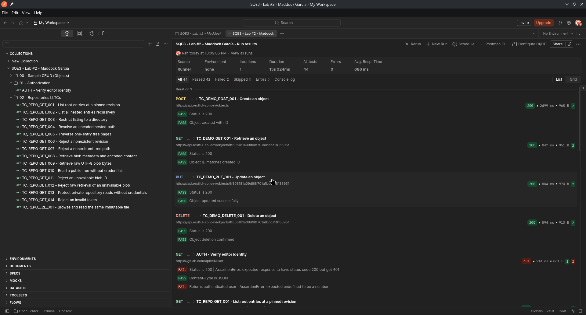

# Lab 2 - Maddock: Repositories implementation

[Back to the group lab](l2.md)

## Contents

- [Activity 1: Tool setup, sample requests and authorization](#activity-1)
- [Activity 2: Assertions and Lab 1 implementation](#activity-2)
- [Activity 3: Preconditions, postconditions and variables](#activity-3)
- [Activity 4: Structure and automated execution](#activity-4)
- [Activity 5: Review and feedback](#activity-5)
- [Sources](#sources)

---

## Activity #1: Tool setup, sample requests and authorization

### 1.1 Individual sample API

Individual CRUD practice uses the public object endpoints of [RESTful API](https://restful-api.dev/).

### 1.2 CRUD requests

Sample CRUD cases are integrated directly in folder `00 - Sample CRUD (Objects)` of the unified collection [GitLab Repositories LLTC](assets/maddock/GitLab_Repositories_LLTC.postman_collection.json), using `demo_base_url = https://api.restful-api.dev`.

| Case ID | Operation | Preconditions | Verification & Cleanup |
| --- | --- | --- | --- |
| `TC_DEMO_POST_001` | POST `/objects` | Unique name and JSON payload. | HTTP `200`, schema valid, persistence GET returns `200`, DELETE returns `200`. |
| `TC_DEMO_GET_001` | GET `/objects/:id` | Disposable object created in setup. | HTTP `200`, ID and payload match created object; teardown deletes object. |
| `TC_DEMO_PUT_001` | PUT `/objects/:id` | Disposable object created in setup. | HTTP `200`, updated fields persist on follow-up GET; teardown deletes object. |
| `TC_DEMO_DELETE_001` | DELETE `/objects/:id` | Disposable object created in setup. | HTTP `200`, deletion message verified, subsequent GET returns `404`. |

### 1.3 Assigned application authorization

**Feature:** Repositories API. **Collection:** [GitLab Repositories LLTC](assets/maddock/GitLab_Repositories_LLTC.postman_collection.json), synced to Postman workspace collection [SQE3 - Lab #2 - Maddock García](https://jdrive.postman.co/workspace/My-Workspace~3198743d-205c-41c7-88c1-9dacb8a59ef1/collection/18752410-5d27c195-492e-4be3-a459-dc4f253a7e3c).

Folder `01 - Authorization` runs `AUTH - Verify editor identity` (`GET {{base_url}}/user` with `PRIVATE-TOKEN: {{token_editor}}`). It asserts HTTP `200` and validates user schema (`id`, `username`) before repository tests run.

---

## Activity #2: Assertions and Lab 1 implementation

### 2.1 Implemented test cases with preconditions and postconditions

All 15 [Lab 1 Repositories LLTCs](../l1/l1_maddock.md#actividad-4) are implemented with their pre- and postconditions:

| Case ID | Criterion | Request | Preconditions | Postconditions |
| --- | --- | --- | --- | --- |
| `TC_REPO_GET_001` | CA-REPO-01 (P1) | `GET /projects/{{project_id}}/repository/tree?ref={{ref}}&recursive=false` | Public project pinned at `ref`. | HTTP `200`. Array contains `README.md` (`blob`) and `docs` (`tree`). No nested paths (`/`). |
| `TC_REPO_GET_002` | CA-REPO-02 (P1) | `GET /projects/{{project_id}}/repository/tree?ref={{ref}}&recursive=true` | Pinned `ref`. | HTTP `200`. Contains `docs/activity-1.md` and `docs/images/`. `README.md` ID matches `readme_blob_sha`. |
| `TC_REPO_GET_003` | CA-REPO-03 (P1) | `GET /projects/{{project_id}}/repository/tree?ref={{ref}}&path=docs&recursive=false` | Pinned `ref`, `path=docs`. | HTTP `200`. Only direct children of `docs/`. Root entries and deeper items excluded. |
| `TC_REPO_GET_004` | CA-REPO-04 (P2) | `GET /projects/{{project_id}}/repository/tree?ref={{ref}}&path=docs%2Fimages&recursive=false` | Pinned `ref`, encoded path. | HTTP `200`. Returns only direct children of `docs/images/`. |
| `TC_REPO_GET_005` | CA-REPO-05 (P2) | `GET /projects/{{project_id}}/repository/tree?ref={{ref}}&per_page=1&page=1` | Pinned `ref`, `per_page=1`. | HTTP `200`. Exactly 1 entry on page 1. Sequential traversal yields 4 total root entries without duplicates. |
| `TC_REPO_GET_006` | CA-REPO-06 (P2) | `GET /projects/{{project_id}}/repository/tree?ref={{missing_ref}}` | Absent revision `missing_ref`. | HTTP `404`. Error returned. Follow-up GET at valid `ref` returns `200`. |
| `TC_REPO_GET_007` | CA-REPO-07 (P2) | `GET /projects/{{project_id}}/repository/tree?ref={{ref}}&path={{missing_path}}` | Absent directory `missing_path`. | HTTP `404`. Error matches `Tree Not Found`. Follow-up GET at `ref` returns `200`. |
| `TC_REPO_GET_008` | CA-REPO-08 (P1) | `GET /projects/{{project_id}}/repository/blobs/{{readme_blob_sha}}` | Valid `readme_blob_sha`. | HTTP `200`. Base64 decoded length equals `size` (194 B). Recomputed Git blob SHA-1 (`blob 194\0` + bytes) equals `readme_blob_sha`. |
| `TC_REPO_GET_009` | CA-REPO-09 (P1) | `GET /projects/{{project_id}}/repository/blobs/{{readme_blob_sha}}/raw` | Valid `readme_blob_sha`. | HTTP `200`. Raw text contains `# Laboratorio Semana 1`. Computed Git blob SHA-1 of raw bytes equals `readme_blob_sha`. |
| `TC_REPO_GET_010` | CA-REPO-10 (P2) | `GET /projects/{{project_id}}/repository/tree?ref={{ref}}` (no auth) | Public project, credentials omitted. | HTTP `200`. Returned entries match authenticated baseline query identically. |
| `TC_REPO_GET_011` | CA-REPO-11 (P2) | `GET /projects/{{project_id}}/repository/blobs/{{missing_blob_sha}}` | Absent blob SHA. | HTTP `404`. Error returned. Follow-up GET to valid README blob returns `200`. |
| `TC_REPO_GET_012` | CA-REPO-12 (P2) | `GET /projects/{{project_id}}/repository/blobs/{{missing_blob_sha}}/raw` | Absent blob SHA. | HTTP `404`. Error payload returned instead of raw file bytes. |
| `TC_REPO_GET_013` | CA-REPO-13 (P1) | `GET /projects/{{private_project_id}}/repository/tree?ref={{private_ref}}` (no auth) | Private project `86430922`, valid token for follow-up. | HTTP `404` (privacy masking unauth). Follow-up with valid `token_editor` returns `200` with repository tree. |
| `TC_REPO_GET_014` | CA-REPO-14 (P1) | `GET /projects/{{project_id}}/repository/tree?ref={{ref}}` (`PRIVATE-TOKEN: invalid-token-sqe3`) | Public project, invalid token. | HTTP `401`. `401 Unauthorized` returned. Follow-up with valid `token_editor` returns `200`. |
| `TC_REPO_E2E_001` | CA-REPO-15 (P0) | Chained E2E flow | Public project pinned at `ref`. | HTTP `200`. Root tree -> recursive tree -> blob JSON -> raw blob -> second recursive tree matches baseline identically. |

### 2.2 Post-response assertions

- **Status and headers:** Assert HTTP status (`200`, `401`, `404`) and `Content-Type: application/json`.
- **JSON Schema:** Validates entry keys (`id`, `name`, `type`, `path`, `mode`) and blob metadata (`size`, `encoding`, `content`, `sha`).
- **Cryptographic verification:** Injects Git header `blob <size>\0` before content and computes SHA-1 using `CryptoJS.SHA1`, validating decoded Base64 and raw bytes against `38475efa6b4cd07666eacc81bafcb9d9c5b4664a`.
- **Dynamic pagination:** Requests pages sequentially with `per_page=1`, confirming 1 entry per page and verifying that combined entries match the 4 root entries without duplicates.
- **Access control:** Verifies anonymous read access on public repos, privacy masking (`404`) on private repo `86430922`, and `401` rejection for invalid credentials.

---

## Activity #3: Preconditions, postconditions and variables

### 3.1 Idempotency and environment isolation

All tests target read-only endpoints against pinned revision `bee3de554beadc2569fc232da1b807d2f0d47d72`. No files, branches, or tags are created, ensuring full idempotency without teardown or cleanup steps.

### 3.2 Variable scopes

| Variable | Scope | Value / Purpose |
| --- | --- | --- |
| `base_url` | Environment / Collection | `https://gitlab.com/api/v4` |
| `project_id` | Environment / Collection | `86160682` (public test project) |
| `ref` | Environment / Collection | `bee3de554beadc2569fc232da1b807d2f0d47d72` (pinned commit SHA) |
| `readme_blob_sha` | Environment / Collection | `38475efa6b4cd07666eacc81bafcb9d9c5b4664a` (`README.md` blob SHA) |
| `private_project_id` | Environment / Collection | `86430922` (private test project) |
| `private_ref` | Environment / Collection | `master` (private branch) |
| `missing_ref` | Environment / Collection | `sqe3-missing-ref-nonexistent` |
| `missing_path` | Environment / Collection | `sqe3-absent-path-nonexistent` |
| `missing_blob_sha` | Environment / Collection | `0000000000000000000000000000000000000000` |
| `token_editor` | Environment / CLI | Personal access token with `api`/`read_api` scope (kept local). |

---

## Activity #4: Structure and automated execution

### 4.1 Collection structure and conventions

The unified collection consolidates all lab activities into three ordered folders:
1. **`00 - Sample CRUD (Objects)`:** 4 public object requests (`POST`, `GET`, `PUT`, `DELETE`).
2. **`01 - Authorization`:** Fast-failing identity probe (`GET /user`).
3. **`02 - Repositories LLTCs`:** 15 repository test cases in numeric sequence.

### 4.2 Execution

Run the tests using the Postman app. I'm fairly sure you can do them using the postman CLI too.

---

## Activity #5: Review and feedback

### 5.1 Reviewed implementation

Pending.

### 5.2 Feedback

Pending.

---

## Sources

- [RESTful API](https://restful-api.dev/).
- [GitLab Repositories API](https://docs.gitlab.com/api/repositories/).
- [GitLab REST authentication](https://docs.gitlab.com/api/rest/authentication/).
- [GitLab REST pagination](https://docs.gitlab.com/api/rest/#pagination).
- [Postman Sandbox API reference](https://learning.postman.com/docs/tests-and-scripts/write-scripts/postman-sandbox-reference/overview/).
- [Lab 1 - Maddock](../l1/l1_maddock.md#actividad-4).
