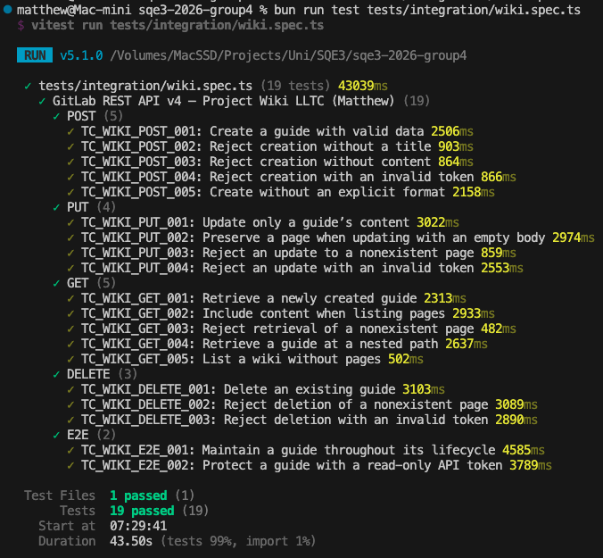

# Lab 3 — Matthew: Project Wiki

[Group lab](l3.md) · [Lab 1 cases](../l1/l1_matthew.md#casos-lltc) · [Lab 2 implementation](../l2/l2_matthew.md)

**Feature:** GitLab project Wiki. The migration keeps the 19 LLTC IDs and the empty-update and reader-scope adaptations from Lab 2. Tests send real requests through Got, assert results with Vitest and validate response bodies with Zod.

## Contents

- [Activity 1: Feedback and automated collection run](#activity-1)
- [Activity 2: API request definition](#activity-2)
- [Activity 3: Test runner definition](#activity-3)
- [Activity 4: Collaboration and integration](#activity-4)
- [Activity 5: First requests and test lifecycle](#activity-5)
- [Activity 6: LLTC migration and validation](#activity-6)

---

<a id="activity-1"></a>

## Activity #1: Feedback and automated collection run

### 1.1 Improvements carried into the migration

Each case gets a unique name and its own fixture. Status, JSON headers, field types and relevant values are checked explicitly. Follow-up reads verify persistence or unchanged data. Cleanup errors fail the test instead of being hidden, and only pages registered by the current case are deleted.

The [Lab 2 conditions](../l2/assets/matthew/pre_post_conditions_matthew.md) remain the per-case reference. Full-list comparisons require no other Wiki writers during execution.

### 1.2 Automatic Postman execution

The source is the [exported Wiki collection](../l2/assets/matthew/GitLab_Wiki_LLTC.postman_collection.json). The recorded run used Newman 6.2.3. The htmlextra reporter generates the HTML dashboard retained as execution evidence.

Copy the [shared Postman environment](../l2/assets/GitLab_Project.postman_environment.json) outside the repository and fill in its local values. The command reads that JSON file; it does not map `.env` values automatically:

| Postman variable | Local configuration |
| --- | --- |
| `base_url` | `GITLAB_BASE_URL` |
| `project_id` | `GITLAB_WIKI_PROJECT_ID` |
| `empty_project_id` | `GITLAB_WIKI_EMPTY_PROJECT_ID` |
| `token_editor` | `GITLAB_TOKEN_EDITOR` |
| `token_reader` | `GITLAB_TOKEN_READER` |
| `reader_update_expected_status` | Keep `403`. |
| `reader_delete_expected_status` | Keep `403`. |

From the repository root, with Newman and newman-reporter-htmlextra installed in the same tooling environment:

```sh
newman run \
  "wiki/labs/l2/assets/matthew/GitLab_Wiki_LLTC.postman_collection.json" \
  -e /absolute/path/to/gitlab-wiki.local.postman_environment.json \
  --reporters cli,htmlextra \
  --reporter-htmlextra-export wiki/labs/l3/assets/matthew/newman_wiki_report.html \
  --reporter-htmlextra-skipSensitiveData \
  --reporter-htmlextra-title "GitLab Wiki — Newman" \
  --reporter-htmlextra-timezone America/Bogota \
  --timeout-request 20000 --timeout-script 120000 --color off
```

**Saved run — November 15, 2026:** [Newman HTML report](assets/matthew/newman_wiki_report.html): 1 iteration, 93 HTTP requests and 416 assertions, with 0 failures; duration 43.1 seconds. Exit code 0. The requests include setup, verification and cleanup, while the collection contains 19 LLTCs plus authorization.

Open the linked HTML report in a browser to inspect the run details.

The [Lab 2 Runner screenshot](../l2/assets/matthew/GitLab_Wiki_LLTC_run.png) remains the earlier baseline: 416 assertions passed, with no failures, skips or errors. It is separate from the Newman run and from Vitest's 19-case count.

### 1.3 Difficulties and possible defects

| Finding | Resolution or current limit |
| --- | --- |
| Display title differs from submitted path | Expected titles use the final path component with hyphens rendered as spaces. The returned slug is retained and URL-encoded once for requests. |
| Empty update returns `200` | `TC_WIKI_PUT_002` verifies a Markdown no-op and unchanged data after GET. It does not validate the original L1 rejection criterion. |
| Reader setup | A separate token with only `read_api` can belong to the same account. The case verifies scope restrictions, not two different project roles. |
| Different error bodies | Validation can return `{ "error": "title is missing" }`, authentication/not-found responses can use `message`, and scope errors include `insufficient_scope`. The Zod schema covers these forms while statuses remain explicit. |
| Earlier cleanup DELETE returned `422` | The later run succeeded. The cause was not established; the code reports the slug, status and response if cleanup fails again. |
| Newman sandbox compatibility | The collection uses an async script scope and callback-backed sendRequest promises. The adapted export passed all 416 assertions under Newman. |

These observations do not establish a confirmed application defect. The no-op and reader-scope variants remain explicitly separated from the original L1 criteria.

---

<a id="activity-2"></a>

## Activity #2: API request definition

The [group comparison](l3.md#activity-2) selects Got `16.2.0`. Wiki uses [createGitLabClient](../../../src/core/client.ts), creating separate editor, invalid-token and reader clients instead of maintaining a second network layer.

The client supplies the base URL, JSON handling, `Accept`, `PRIVATE-TOKEN`, User-Agent and a request timeout of 10 seconds by default. HTTP errors are returned to the test for explicit assertions. `GITLAB_RETRY_LIMIT` defaults to `0`; keeping it at zero makes the integration run observe the first response.

The implementation notes record local HTTP checks for anonymous requests with `token: ''`, token isolation, shared headers and retries. No separate report is attached for those checks. The Got recommendation is explained in the [group report](l3.md#activity-2).

---

<a id="activity-3"></a>

## Activity #3: Test runner definition

The implementation uses Vitest `5.1.0` with explicit imports of `describe`, `expect` and the extended `test` fixture. The [group report](l3.md#activity-3) records the alternatives and the recommendation based on the previous TODOist framework and team discussion.

All cases stay in one [wiki.spec.ts](../../../tests/integration/wiki.spec.ts), grouped by POST, PUT, GET, DELETE and E2E. Each case remains independently selectable by its ID. Wiki sets `concurrent: false` and a 60-second case timeout. This prevents overlap within the Wiki spec. Full-list comparisons still require that no other process or user writes to the same Wiki during the run.

---

<a id="activity-4"></a>

## Activity #4: Collaboration and integration

The [group proposal](l3.md#activity-4) uses `main`, `develop`, focused feature/fix branches and Conventional Commits. A suitable migration commit is:

```text
test(wiki): migrate Wiki LLTCs to Vitest
```

The Wiki change adds its schema, fixture and spec while keeping the teammates' files in their existing locations. PR validation should name the selected cases, target and results. Live tests need local or CI-provided tokens; secret values are not part of the diff. Remote branch protection and CI execution remain unverified.

---

<a id="activity-5"></a>

## Activity #5: First requests and test lifecycle

### 5.1 Requests without page setup

`TC_WIKI_GET_003` uses a unique absent slug and verifies `404` without creating a page. It was the first focused live check during implementation. `TC_WIKI_GET_005` lists a separate, already empty Wiki twice; it does not empty a populated Wiki to prepare its data.

Both require configured projects, Wiki access and a valid editor token.

### 5.2 Assertions and schemas

[wiki.schema.ts](../../../src/domains/wiki/wiki.schema.ts) defines page, summary, content-list and error schemas. `expectJson` checks status and media type; `expectPage` checks title, slug, format and content. For DELETE `204`, the test checks an empty body instead of parsing JSON.

Response schemas validate field types at runtime. Configuration checks reject missing tokens, nonnumeric project IDs and invalid retry limits before the relevant request runs.

### 5.3 Hooks and fixture implementation

The group report explains Vitest hooks. Wiki uses the equivalent setup/teardown boundary through `test.extend` in [tests/support/wiki.ts](../../../tests/support/wiki.ts):

1. Construct a new `WikiSession` with unique case data and isolated clients.
2. Let the case create a page only when its preconditions require one.
3. Register returned slugs before asserting the created page's fields.
4. Execute cleanup in `finally`, including after assertion failures.
5. Delete only owned pages and verify `404`; aggregate failures with recovery details.

Normal deletion cases remove their successfully deleted page from the fixture's owned set. There is no cross-case page dependency. If execution is interrupted, or a creation succeeds without returning its slug, manual recovery of that run's uniquely named page may still be needed.

---

<a id="activity-6"></a>

## Activity #6: LLTC migration and validation

### 6.1 Traceability

Every row maps to a case in [wiki.spec.ts](../../../tests/integration/wiki.spec.ts) and its [Lab 2 conditions](../l2/assets/matthew/pre_post_conditions_matthew.md).

| LLTC | Main verification | State verification |
| --- | --- | --- |
| `TC_WIKI_POST_001` | Create with valid data: `201`, page schema and values. | GET returns the created page. |
| `TC_WIKI_POST_002` | Missing title: `400`, error schema and no page payload. | Complete slug set remains unchanged. |
| `TC_WIKI_POST_003` | Missing content: `400`. | Generated slug is absent from listing and GET. |
| `TC_WIKI_POST_004` | Invalid token: `401`. | No page is created at the generated slug. |
| `TC_WIKI_POST_005` | Omitted format: `201`, default Markdown. | GET preserves page values. |
| `TC_WIKI_PUT_001` | Update content: `200`. | GET confirms new content with unchanged identity and format. |
| `TC_WIKI_PUT_002` | Empty update: `200`, unchanged page. | GET confirms the L2 no-op variant. |
| `TC_WIKI_PUT_003` | Update nonexistent page: `404`. | GET remains `404`. |
| `TC_WIKI_PUT_004` | Invalid-token update: `401`. | Editor GET returns original values. |
| `TC_WIKI_GET_001` | Retrieve a prepared page: `200`. | Response and follow-up GET match the fixture. |
| `TC_WIKI_GET_002` | List with content: `200`. | Paginated listing contains the prepared page and content. |
| `TC_WIKI_GET_003` | Retrieve nonexistent page: `404`. | No resource is created. |
| `TC_WIKI_GET_004` | Create at nested path: `201`, returned slug and leaf title. | GET resolves the encoded slug and original content. |
| `TC_WIKI_GET_005` | Empty Wiki listing: `200`, empty array. | Second listing remains empty; no mutation. |
| `TC_WIKI_DELETE_001` | Delete prepared page: `204`, empty body. | GET is `404`; full list excludes the page. |
| `TC_WIKI_DELETE_002` | Delete nonexistent target: `404`. | Control page remains unchanged. |
| `TC_WIKI_DELETE_003` | Invalid-token deletion: `401`. | Prepared page remains readable and unchanged. |
| `TC_WIKI_E2E_001` | Create, read, update, list and delete. | Updated values persist; deleted page is absent from GET and listing. |
| `TC_WIKI_E2E_002` | Reader GET `200`; reader PUT/DELETE `403`. | Editor GET confirms unchanged data after each rejected write. |

Cases that create resources also run fixture cleanup. Pagination is followed before concluding that a page is present or absent. The reader case does not require different user accounts, but does require different editor and reader token values.

### 6.2 Running the tests

Copy [.env.example](../../../.env.example) to a local `.env` and configure its Wiki project IDs and tokens. The writable and empty Wiki projects must be different. Use `api` for the editor and only `read_api` for the reader. Tokens stay local.

```sh
bun install --frozen-lockfile
bun run typecheck
bun run test tests/integration/wiki.spec.ts
bun run test tests/integration/wiki.spec.ts -t TC_WIKI_POST_001
```

<a id="validation"></a>

### 6.3 Recorded validation

The saved Vitest screenshot shows all 19 Wiki cases passing in a full run. Earlier implementation checks are recorded separately below.

| Check | Recorded result |
| --- | --- |
| Full Wiki run — saved screenshot | 19 passed, 0 failed, 0 skipped; total duration 43.50 seconds. |
| Earlier live Wiki migration run | 19 passed, 0 failed, 0 skipped; 41.76 seconds. Recorded during implementation on November 15, 2026. |
| Focused run after shared-client refactoring | `TC_WIKI_GET_003` and `TC_WIKI_DELETE_003` passed, including fixture cleanup. |
| Type checking | Reported as passed for the source, schemas, support code and integration specs at the time of the check. |
| Scoped lint and formatting | Passed for the Wiki files and shared client. |
| Client checks on localhost | Token isolation, anonymous headers and configurable retries behaved as expected. |
| CI / coverage | Not measured by these runs. No remote CI result or coverage percentage is reported. |



Newman counts assertions, while Vitest counts test cases; the totals measure different things.

### 6.4 Compatibility and remaining work

The selected dependencies are Got `16.2.0`, Vitest `5.1.0` and Zod `4.6.7`. The implementation notes record Bun `1.4.4` for tooling/type checks and Node `22.23.2` for the earlier live Vitest runs. The saved screenshot does not identify its Node version. Node `22.23.2` is outside the project’s declared range (`>=26.13.1 <27`). The pinned Node `26.13.1` target still needs its own execution check.

Source/test aliases resolve through the Vitest configuration. The Node test setup loads `.env` explicitly. `@types/bun` supplies Bun types while Zod validates external JSON. Got and Vitest use the project's ESM setup.

Preparing projects and discovering resource IDs through API helpers, rather than relying on preconfigured IDs, is future setup work. It should not make one spec depend on running another. Concurrent Wiki cases will also need isolation for the whole-list comparison before enabling that mode.

## Sources

- [GitLab Project wikis API](https://docs.gitlab.com/api/wikis/).
- [GitLab REST authentication](https://docs.gitlab.com/api/rest/authentication/).
- [Got documentation](https://github.com/sindresorhus/got#documentation).
- [Vitest fixtures](https://vitest.dev/guide/test-context.html).
- [Zod](https://zod.dev/).
