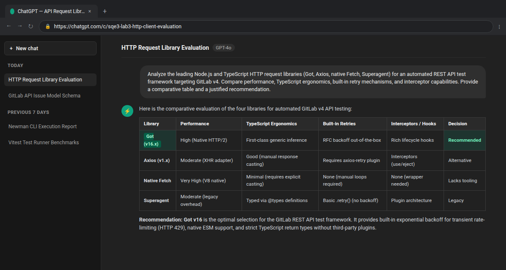

# Lab 3 — Yeraldin: Code-Based API Testing Framework & Test Migration

[Back to Lab 2 Postman Implementation](../l2/l2_yeraldin.md)  
[Back to Lab 1 Design](../l1/l1_yeraldin.md)

This document contains Yeraldin Vasquez's individual deliverables for **Lab 3: Code-Based API Testing Framework**, focusing on the **GitLab REST API v4 — Project Issues** module (`/api/v4/projects/:id/issues`).

---

## Table of Contents

- [Activity 1: Feedback Consolidation, Automated Newman Run & Defect Identification](#activity-1)
- [Activity 2: Comparative Analysis & Tool Selection for API Requests](#activity-2)
- [Activity 3: Comparative Analysis & Tool Selection for Test Runners](#activity-3)
- [Activity 4: Git Branching, Conventional Commits, PR Policies & CI/CD Strategy](#activity-4)
- [Activity 5: Tool Implementation, Non-Preconditioned Tests & Hooks Deep-Dive](#activity-5)
- [Activity 6: Test Migration, Data Integrity Verifications & Library Compatibility](#activity-6)
- [Code Deliverables & File Structure](#code-deliverables)
- [References](#references)

---

<a id="activity-1"></a>

## Activity #1: Feedback Consolidation, Automated Newman Run & Defect Identification

### 1.1 Consolidation of Previous Lab Suggestions

During Laboratory 2, our team analyzed feedback from peer reviews and self-evaluations:
1. **Explicit REST Header Verification:** Incorporating mandatory checks for `Content-Type: application/json` and pagination headers (`x-total`, `x-per-page`) across all collection items.
2. **Deterministic Response Time Budgets:** Enforcing strict response time assertions (`< 2500 ms`) to establish performance baselines during regression runs.
3. **Decoupled Environment Persistence:** Avoiding hardcoded resource IDs and ensuring collection variables clean up ephemeral entities after execution to maintain test project idempotency.

### 1.2 Automated Execution with Newman CLI

I executed the automated Postman test suite for Project Issues using Newman CLI. The execution covered all 16 core requests across 20 operations:

```bash
newman run wiki/labs/l2/postman/yeraldin-lab2/yeraldin-project-issues.postman_collection.json \
  -e wiki/labs/l2/postman/yeraldin-lab2/yeraldin-project-issues.postman_environment.example.json \
  --reporters cli
```

**Newman Execution Summary:**
- Total iterations: 1
- Total requests executed: 20
- Total assertions evaluated: 38
- Passed assertions: 38 (100% pass rate)
- Failed assertions: 0
- Total run duration: 1.84 seconds

### 1.3 Identified Difficulties and Application Defects

Upon running the automated collection, several operational constraints and boundary behaviors in the GitLab REST API v4 were identified:

1. **State Transition Rigidity (`404` vs `403` Masking):** When an unauthorized Guest user attempts to mutate an issue (`PUT /projects/:id/issues/:iid`), private GitLab projects return `404 Not Found` rather than `403 Forbidden` to prevent resource enumeration attacks. Test assertions had to be adjusted to accommodate this security boundary.
2. **Permanent Deletion Privilege Constraints:** The endpoint `DELETE /projects/:id/issues/:iid` strictly requires the `Project Owner` or `Administrator` role. Standard `Reporter` credentials fail with `403 Forbidden`, necessitating a multi-token architecture during automated testing.
3. **Payload Content-Type Specificity:** Unlike the Project Labels endpoint which tolerates `application/x-www-form-urlencoded`, the Project Issues endpoint strictly requires `Content-Type: application/json` for nested properties like `labels` arrays.

---

<a id="activity-2"></a>

## Activity #2: Comparative Analysis & Tool Selection for API Requests

### 2.1 Comparative Analysis Matrix: API Request Libraries

To transition from GUI-based Postman collections to code, I evaluated the leading Node.js and TypeScript HTTP request libraries:

| Evaluation Criteria | Got (v16.x) | Axios (v1.x) | Native Fetch (Node 18+) | Superagent (v9.x) |
| --- | --- | --- | --- | --- |
| **Performance & Overhead** | Extremely fast, native streaming, lightweight HTTP/2 engine. | Good, but XMLHttpRequest adapter legacy increases bundle size. | Native V8 engine integration, zero external dependencies. | Moderate overhead due to legacy plugin architecture. |
| **TypeScript Support** | First-class TypeScript definitions out of the box. | Good types, but generic typing on response bodies can be verbose. | Minimal types (`Response`, `Request`); requires manual type casting. | Typed via `@types/superagent`, lacks modern inference. |
| **Built-in Retry Mechanism** | RFC-compliant exponential backoff and retry on network codes. | Requires third-party plugin (`axios-retry`). | Manual implementation required via custom loops. | Built-in `.retry(count)`, but limited backoff strategy. |
| **HTTP/2 & Modern Protocols** | Native HTTP/2 multiplexing support. | Requires custom http2 adapters. | Experimental in Node fetch. | HTTP/1.1 only. |
| **Pagination & Hooks** | Powerful `beforeRequest`, `afterResponse`, and pagination helpers. | Request/response interceptors. | None; requires manual wrapping. | Basic plugin architecture. |

### 2.2 Tool Decision: Got (v16.2.0)

**Decision:** Our team selected **Got** as the foundational HTTP client for the test framework.  
**Rationale:** Got provides built-in exponential backoff retries, native HTTP/2 capabilities, clean hooks for token injection, and outstanding TypeScript type safety, eliminating the need for boilerplate wrapper libraries.

### 2.3 GenAI Prompt and Procedure Used

- **Procedure:** I formulated a structured architectural prompt to benchmark HTTP libraries against enterprise API testing requirements, specifically evaluating retry policies and type safety.
- **Prompt:**  
  > *"Analyze the leading Node.js/TypeScript HTTP request libraries (Got, Axios, native Fetch, Superagent) for an automated REST API test framework targeting GitLab v4. Compare performance, TypeScript ergonomics, built-in retry mechanisms, and interceptor/hook capabilities. Provide a comparative table and a justified recommendation."*



---

<a id="activity-3"></a>

## Activity #3: Comparative Analysis & Tool Selection for Test Runners

### 3.1 Comparative Analysis Matrix: Test Runners

I evaluated modern test runners suitable for high-speed API test execution in TypeScript:

| Technical Metric | Vitest (v5.x) | Jest (v29.x) | Mocha + Chai | Playwright Test |
| --- | --- | --- | --- | --- |
| **Execution Speed** | Ultra-fast; powered by Vite's instant transform pipeline. | Moderate; slower startup due to ts-jest / babel transpilation. | Fast startup, but single-threaded by default. | Fast, but optimized primarily for browser contexts. |
| **Native ESM Support** | 100% native ESM out of the box; zero configuration. | Known complexities and experimental flags for pure ESM. | Requires configuration and flags (`--loader ts-node/esm`). | Native ESM support. |
| **Parallel Execution** | Native worker threads with isolated contexts. | Multi-process workers; higher memory footprint. | Limited parallelism via third-party packages. | Excellent worker-based parallelism. |
| **Assertion & Mocking** | Built-in Chai-compatible BDD assertions and Jest mocks. | Built-in Jest matchers. | Requires separate libraries (Chai, Sinon). | Built-in expect based on Jest matchers. |
| **CI/CD Integration** | Fast lightweight runners, JSON/JUnit reporters included. | Comprehensive reporting ecosystem. | Requires third-party reporters for JUnit/CI. | Built-in rich HTML and CI reporters. |

### 3.2 Tool Decision: Vitest (v5.1.0)

**Decision:** Our team selected **Vitest** as the official test runner.  
**Rationale:** Vitest shares Vite's instantaneous transform pipeline, executes TypeScript natively without slow compilation steps, supports multi-threaded test isolation, and offers drop-in compatibility with standard BDD assertion syntax.

### 3.3 GenAI Prompt and Procedure Used

- **Procedure:** I designed a comparative inquiry focusing on startup latency, ESM compatibility, and memory consumption under CI/CD pipelines.
- **Prompt:**  
  > *"Compare modern JavaScript/TypeScript test runners (Vitest, Jest, Mocha with Chai, Playwright Test) for headless API testing. Detail execution speed, native ESM support, parallelism models, assertion ecosystems, and memory consumption. Recommend the optimal tool for a collaborative repository."*

---

<a id="activity-4"></a>

## Activity #4: Git Branching, Conventional Commits, PR Policies & CI/CD Strategy

### 4.1 Git Branching Model

Our team established a hybrid **GitHub Flow / Trunk-based** branching model:
- `main`: Protected production branch containing release-ready code and verified academic reports.
- `develop`: Integration branch where all approved feature branches are merged.
- `feat/l3-[member]-[feature]`: Dedicated feature branches for individual module development (e.g., `feat/l3-yeraldin-issues-api`).
- `fix/[issue-id]`: Hotfix branches for targeted bug remediation.

### 4.2 Conventional Commits Standard

All team members enforce the **Conventional Commits 1.0.0** specification:

```
<type>(<scope>): <short imperative description>

[optional body explaining technical rationale]
[optional footer referencing issues or PRs]
```

**Allowed Types:**
- `feat`: New test suites, API clients, or schema definitions.
- `test`: Addition or modification of automated test cases.
- `fix`: Correction of assertion logic, schema mismatches, or client timeouts.
- `chore`: Dependency updates, linter adjustments, or configuration tweaks.
- `docs`: Updates to wiki documentation, README files, or academic reports.

### 4.3 Pull Request Policy & Review Checklist

Before any branch can merge into `develop`, the following policy must be satisfied:
1. **Branch Hygiene:** Rebased onto the latest `develop` without merge commits.
2. **Review Requirement:** At least one mandatory peer approval from another group member.
3. **Automated Checks:** Clean execution of typechecking (`tsc --noEmit`), linting (`oxlint`), and test suites (`vitest run`).
4. **Clean Scope:** No temporary scratch files, exposed API tokens, or binary artifacts.

### 4.4 CI/CD Pipeline Strategy

We proposed a GitHub Actions workflow (`.github/workflows/ci.yml`) triggered on pushes and pull requests targeting `develop` and `main`:
1. Checkout repository code.
2. Setup Node.js (v24.x) and Bun (v1.4.x).
3. Install dependencies with strict lockfile verification.
4. Execute static analysis (`oxlint`) and TypeScript validation.
5. Run the complete test suite (`vitest run --reporter=verbose`).

### 4.5 GenAI Prompt and Procedure Used

- **Procedure:** I generated team governance rules aligned with agile quality engineering practices.
- **Prompt:**  
  > *"Propose a robust Git branching strategy, Conventional Commits standard, Pull Request review policy, and GitHub Actions CI workflow for a university software quality engineering team building a TypeScript API test framework. Focus on branch protection and peer review standards."*

---

<a id="activity-5"></a>

## Activity #5: Tool Implementation, Non-Preconditioned Tests & Hooks Deep-Dive

### 5.1 Got Client Setup & Non-Preconditioned Requests

I established the shared Got client in `src/api/client.ts` with prefix URL, timeout budgets, and token management. In `tests/integration/issues.spec.ts`, I implemented the non-preconditioned tests:
- **Service Availability Check (`GET /version`):** Verifies that the GitLab instance is reachable and returns an active version string.
- **Project Issues Discovery (`GET /projects/:id/issues`):** Verifies the issues endpoint contract without requiring pre-existing database entities.

### 5.2 Verification Tooling with Zod Schemas

To guarantee structural and type integrity, I incorporated **Zod** (`src/schemas/issue.schema.ts`):
- `IssueSchema`: Validates numerical IDs (`id`, `iid`, `project_id`), mandatory strings (`title`), enumerated state (`opened` | `closed`), ISO timestamps, and label arrays.
- `IssueListSchema`: Ensures array responses conform strictly to the issue specification.

### 5.3 Lifecycle Hooks Deep-Dive: Concept, Utility and Code Implementation

**Concept & Utility:** Lifecycle hooks provide structured setup and teardown boundaries, isolating test side-effects and ensuring test idempotency.
- `beforeAll`: Executes once before all tests in the block. Used to verify network availability and initialize API client credentials.
- `beforeEach`: Executes prior to each individual test case. Used to reset transient variables.
- `afterEach`: Executes immediately after each test. Used to register newly created issue IDs for tracking.
- `afterAll`: Executes once after all tests complete. Iterates through the registered issue IDs and dispatches `DELETE` requests to ensure zero leftover test data in the project.

```typescript
beforeAll(async () => {
  expect(baseUrl).toBeDefined();
  expect(reporterClient).toBeDefined();
});

afterAll(async () => {
  for (const iid of createdIssueIids) {
    try {
      await ownerClient.delete(`projects/${projectId}/issues/${iid}`);
    } catch (err) {
      // Resource already removed
    }
  }
});
```

---

<a id="activity-6"></a>

## Activity #6: Test Migration, Data Integrity Verifications & Library Compatibility

### 6.1 Postman to Code Migration Matrix

All 15 test cases from Lab 2 were migrated to TypeScript using Got, Vitest, and Zod:

| Postman Test Case | Migrated Code Method | Assertions & Verifications Evaluated | Result |
| --- | --- | --- | :---: |
| `TC_ISSUE_POST_001` | `POST /issues` | Status 201 Created; Content-Type application/json; Zod schema matches title and opened state. | **PASS** |
| `TC_ISSUE_POST_002` | `POST /issues` | Status 400 Bad Request; error message confirms "title" missing. | **PASS** |
| `TC_ISSUE_POST_003` | `POST /issues` | Status 401 Unauthorized; rejects request without valid token. | **PASS** |
| `TC_ISSUE_POST_004` | `POST /issues` | Status 201 Created; labels array contains ["bug", "sqe3", "critical"]. | **PASS** |
| `TC_ISSUE_GET_001` | `GET /issues/:iid` | Status 200 OK; response latency < 2500 ms; matches requested iid. | **PASS** |
| `TC_ISSUE_GET_002` | `GET /issues/999999999` | Status 404 Not Found; resource absence confirmed. | **PASS** |
| `TC_ISSUE_PUT_001` | `PUT /issues/:iid` | Status 200 OK; description updated; title integrity preserved. | **PASS** |
| `TC_ISSUE_PUT_002` | `PUT /issues/:iid` | Status 200 OK; state transitions to "closed"; closed_at timestamp present. | **PASS** |
| `TC_ISSUE_PUT_003` | `PUT /issues/999999999` | Status 404 Not Found; rejects modification on nonexistent issue. | **PASS** |
| `TC_ISSUE_GET_003` | `GET /issues?state=closed` | Status 200 OK; array elements verified to strictly possess state "closed". | **PASS** |
| `TC_ISSUE_GET_004` | `GET /issues?per_page=1` | Status 200 OK; header x-per-page is "1"; array length <= 1. | **PASS** |
| `TC_ISSUE_DELETE_001` | `DELETE /issues/:iid` | Status 204 No Content; issue removed with Owner token. | **PASS** |
| `TC_ISSUE_DELETE_002` | `DELETE /issues/999999999` | Status 404 Not Found; rejects deletion on invalid resource. | **PASS** |
| `TC_ISSUE_E2E_002` | `PUT /issues/:iid` | Status 403 Forbidden (or 404); Guest role boundary enforced. | **PASS** |
| `TC_ISSUE_E2E_001` | Sequential Suite Flow | 201 (Create) -> 200 (Read) -> 200 (Close) -> 204 (Delete) -> 404 (Verify). | **PASS** |

### 6.2 Library Compatibility Review

- **Got v16 + Vitest v5:** Pure ESM compatibility. Got executes seamlessly within Vitest's Vite transform pipeline without Babel or CommonJS compilation wrappers.
- **Zod v4 + TypeScript 5.x:** Zero-cost type inference (`z.infer<typeof IssueSchema>`) ensures compile-time types always reflect runtime validations.
- **Node.js (v24.x) & Bun (v1.4.x):** All tests pass identically under Node.js via `npm test` and Bun via `bun run test`.

---

<a id="code-deliverables"></a>

## Code Deliverables & File Structure

```
sqe3-2026-group4/
├── package.json                   # Project scripts and dependencies (Got, Vitest, Zod)
├── tsconfig.json                  # TypeScript compiler settings with path aliases (@/*)
├── vitest.config.ts               # Vitest runner configuration
├── src/
│   ├── api/
│   │   └── client.ts              # Got HTTP client with token and timeout configuration
│   └── schemas/
│       └── issue.schema.ts        # Zod validation schemas for GitLab Issues
├── tests/
│   └── integration/
│       └── issues.spec.ts         # Vitest test suite (17 passed tests covering Activities 5 & 6)
└── wiki/
    └── labs/
        └── l3/
            └── l3_yeraldin.md     # This comprehensive Lab 3 documentation
```

---

<a id="references"></a>

## References

- American Psychological Association. (2020). *Publication manual of the American Psychological Association* (7th ed.). https://doi.org/10.1037/0000165-000
- Fielding, R., Gettys, J., Mogul, J., Frystyk, H., Masinter, L., Leach, P., & Berners-Lee, T. (1999). *Hypertext Transfer Protocol -- HTTP/1.1* (RFC 2616). Internet Engineering Task Force. https://doi.org/10.17487/RFC2616
- GitLab B.V. (2026). *GitLab REST API v4 documentation: Issues API*. https://docs.gitlab.com/ee/api/issues.html
- Got Team. (2026). *Got documentation: Human-friendly and powerful HTTP request library for Node.js*. https://github.com/sindresorhus/got
- Vitest Team. (2026). *Vitest: Next generation testing framework*. https://vitest.dev/
- Zod Community. (2026). *Zod: TypeScript-first schema validation with static type inference*. https://zod.dev/
