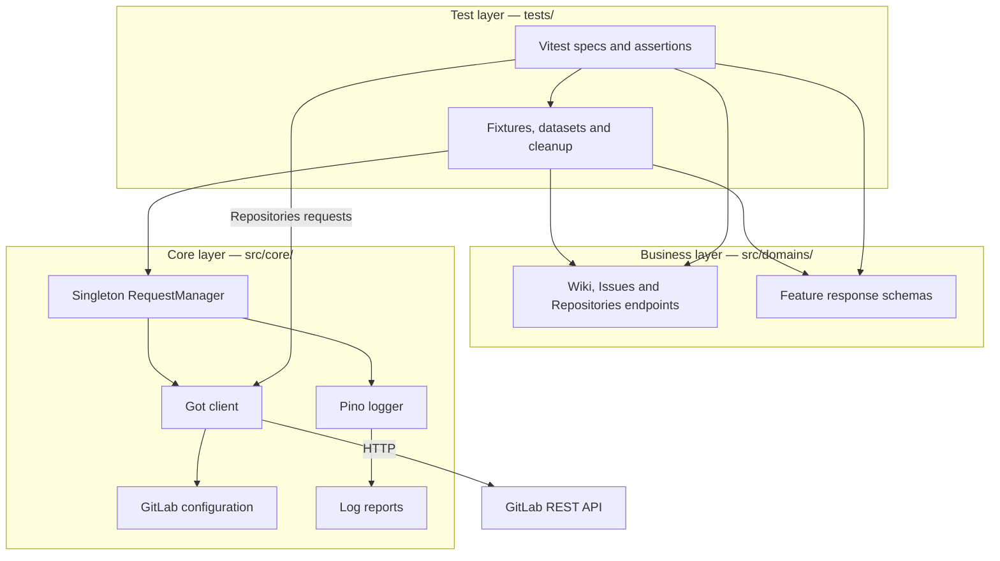

# Lab 4 — Framework architecture

[Back to Lab 4](l4.md)

## Architecture



| Layer | Responsibility |
| --- | --- |
| Test | `tests/unit/` validates the shared core. `tests/integration/` defines feature scenarios and assertions. `tests/support/` manages fixtures, data and cleanup, and `tests/setup/` prepares the environment and per-run log path. |
| Business | `src/domains/` groups endpoint builders and Zod response schemas by feature. |
| Core | `src/core/` configures Got, sends requests through the shared `RequestManager`, records Pino events and summarizes the execution log. |

Wiki uses the shared request manager for live requests. Repositories sends requests through the shared Got client. Labels exercises an in-memory simulation, so its domain contains response schemas. Issues combines simulated assertions with HTTP calls in its fixture.

## Folder structure

```text
src/
├── core/                    # Environment, HTTP client, request manager, logs and reports
└── domains/
    ├── issues/              # Issue routes and schemas
    ├── labels/              # Label schemas
    ├── repositories/        # Repository routes and schemas
    └── wiki/                # Wiki routes and schemas
tests/
├── data/
├── integration/
├── setup/
├── support/
└── unit/
```
