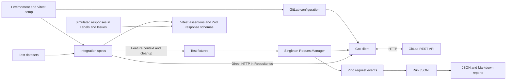
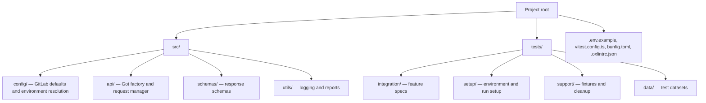

# Lab 4 — Framework architecture

[Back to Lab 4](l4.md)

## Architecture

| Layer | Responsibility |
| --- | --- |
| Configuration and setup | `src/config/` resolves API settings and credentials. `tests/setup/` loads the environment and gives workers the same log path for a run. |
| Specification | `tests/integration/` defines scenarios and asserts status codes, headers, bodies and resource state. |
| Test support | `tests/support/` loads case data, prepares resources and handles cleanup where the feature needs it. |
| HTTP | `src/api/` configures Got. The shared `RequestManager` sends requests with the selected client and returns the response for the spec to check. |
| Response contracts | `src/schemas/` uses Zod to validate response bodies. |
| Logging and reporting | `src/utils/` records request outcomes and summarizes each execution log. |

Wiki uses the shared request manager for live requests. Repositories sends HTTP requests through Got directly. Labels exercises an in-memory simulation, and Issues includes simulated responses alongside HTTP requests.

## Folder structure

