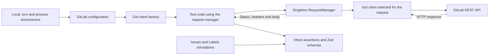
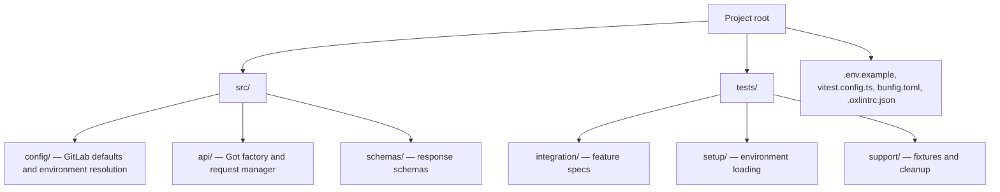

# Lab 4 — Framework architecture

[Back to Lab 4](l4.md)

## Architecture

Vitest loads the local environment before the specs. The client factory applies the URL, timeout, retry policy and credentials. The request manager sends the request with the selected client and returns the complete response. Zod validates response bodies at the test boundary.

## Folder structure

