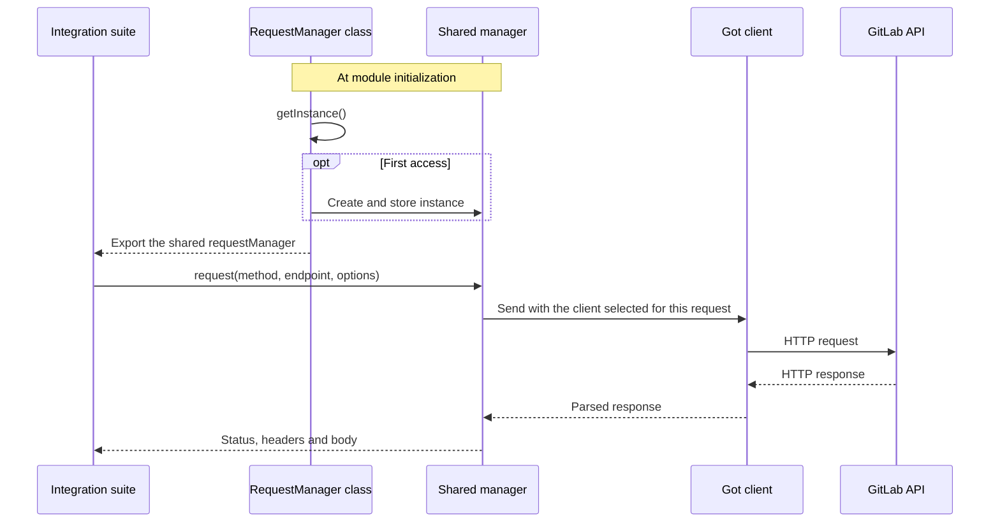

# Lab 4 — API test framework architecture

[Lab 3](../l3/l3.md)

## Activity 1 — Architecture, structure and configuration

The [architecture diagram](architecture.md#architecture) follows a request from the spec through the fixture and HTTP client to GitLab. The [folder diagram](architecture.md#folder-structure) shows where the specs, fixtures, configuration, schemas and reporting tools live.

Use [`.env.example`](../../../.env.example) to configure the local environment. The [README](../../../README.md) explains how to run the suite and check the code with `bun run lint` (Oxlint).

## Activity 2 — Singleton request manager

Wiki now sends requests through the shared manager. The first call to `getInstance()` creates the manager, and subsequent calls in the same module instance return it. Each request can still use a client with its own credentials. [Request manager](../../../src/core/request-manager.ts)

For the Project Wiki request flow, see [Matthew's Lab 4](l4_matthew.md#activity-2--singleton-request-manager).

## Activity 3 — Logging and reports

The framework uses Pino to log test steps and requests made through the shared `RequestManager`. Each request event records the method, elapsed time, the case ID when supplied and the HTTP status when one was received. Keep tokens, headers, URLs and payloads out of log messages.

| Level | Use |
| --- | --- |
| `INFO` | Test steps and HTTP responses below `400`. |
| `WARN` | HTTP `4xx` responses, including those expected by negative test cases. |
| `ERROR` | HTTP `5xx` responses and request failures. A connection failure without a response has no HTTP status. |

Vitest saves `execution.jsonl`, `execution-report.json` and `execution-report.md` together under `logs/run-*/` for each run that emits log events. Use `bun run report:logs` to regenerate the latest report. To read a log in the terminal, pipe the selected JSONL file into `bun run logs:pretty`.

[Pino logger](../../../src/core/logger.ts) · [Report generator](../../../src/core/log-reporter.ts) · [Initial Issues logging implementation](l4_yeraldin.md#activity-3)

## Activity 4 — Test context, preconditions and datasets

Issues uses `IssueContext` to carry data between setup, assertions and cleanup. Yeraldin documents the JSON and CSV datasets in [Issues Activity 4](l4_yeraldin.md#activity-4).

[Wiki test context and datasets](l4_matthew.md#activity-4--test-context-preconditions-and-datasets) covers preconditions, postconditions and cleanup. It also includes the GenAI prompt and the procedure used to generate 12 JSON rows for three Wiki cases.

## Activity 5 — Framework review and continued implementation

The [framework architecture](architecture.md#architecture) shows the shared layers and how they work together. Each feature write-up records its test coverage and how it uses those layers.

- [Project Wiki — coverage and component review](l4_matthew.md#activity-5--wiki-suite-and-framework-review)
- [Project Issues — suite and component review](l4_yeraldin.md#activity-5)

## Participation

| Member                   | Contribution                                                                                                             |
| ------------------------ | ------------------------------------------------------------------------------------------------------------------------ |
| Alexis                   | Pending                                                                                                                  |
| Maddock                  | Pending                                                                                                                  |
| [Matthew](l4_matthew.md) | Refactored Wiki requests, configured Oxlint, documented the framework diagrams and added Wiki test context and JSON variants. |
| [Yeraldin](l4_yeraldin.md) | Refactored Issues API to Singleton RequestManager, integrated Pino structured logging and reporter, added IssueContext lifecycle and GenAI dynamic datasets. |
