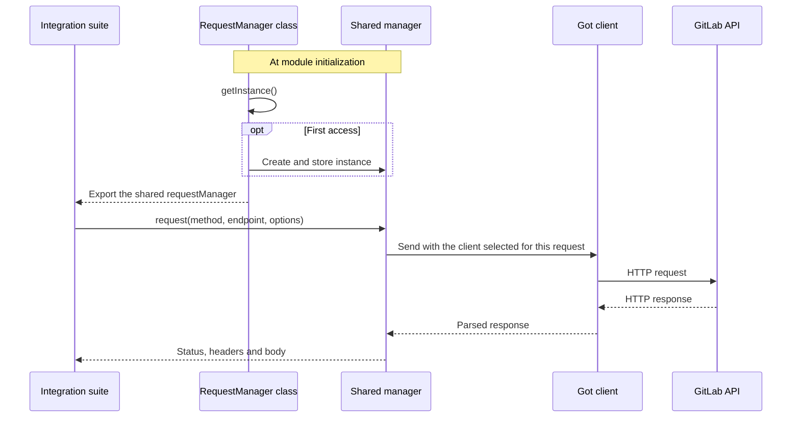

# Lab 4 — API test framework architecture

[Lab 3](../l3/l3.md)

## Activity 1 — Architecture, structure and configuration

[Architecture and folder structure](architecture.md)

## Activity 2 — Singleton request manager

[Request manager implementation](../../../src/api/request-manager.ts)

For the Project Wiki request flow, see [Matthew's Lab 4](l4_matthew.md#activity-2--singleton-request-manager).

## Activity 3 — Logging and reports

For the Pino logger architecture and automated execution reports, see [Yeraldin's Lab 4](l4_yeraldin.md#activity-3--specialized-logging-tool-pino--execution-reports).

## Activity 4 — Test context, preconditions and datasets

For the IssueContext lifecycle management and GenAI dynamic datasets (JSON & CSV), see [Yeraldin's Lab 4](l4_yeraldin.md#activity-4--prepost-conditions-test-context--dynamic-datasets-genai).

## Activity 5 — Framework review and continued implementation

For the GitLab Issues API 24-test suite execution and layer separation, see [Yeraldin's Lab 4](l4_yeraldin.md#activity-5--written-test-suite-continuation-layer-separation--component-documentation).

## Participation

| Member                   | Contribution                                                                                                             |
| ------------------------ | ------------------------------------------------------------------------------------------------------------------------ |
| Alexis                   | Pending                                                                                                                  |
| Maddock                  | Pending                                                                                                                  |
| [Matthew](l4_matthew.md) | Refactored the Wiki tests to use the Singleton request manager, configured Oxlint and documented the framework diagrams. |
| [Yeraldin](l4_yeraldin.md) | Refactored Issues API to Singleton RequestManager, integrated Pino structured logging and reporter, added IssueContext lifecycle and GenAI dynamic datasets. |

