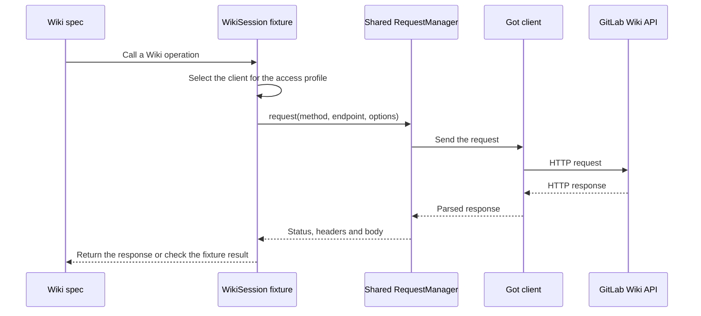

# Lab 4 — Matthew: Project Wiki

[Group lab](l4.md) · [Lab 3 implementation](../l3/l3_matthew.md)

## Activity 1 — Wiki structure

The [Wiki spec](../../../tests/integration/wiki.spec.ts) defines the cases and assertions. The [WikiSession fixture](../../../tests/support/wiki.ts) prepares test data, manages request credentials and tracks pages for cleanup. The [Wiki schemas](../../../src/schemas/wiki.schema.ts) validate response bodies.

## Activity 2 — Singleton request manager

In Lab 3, Wiki sent requests through Got clients. The fixture now chooses the client for the case and passes it to the shared `RequestManager`. This gives requests a common logging path while preserving the editor, reader and invalid-token checks.



## Activity 3 — Logging and reports

Wiki passes the LLTC ID to the request manager so its Pino events can be traced through setup, assertions and cleanup. Under the [team logging conventions](l4.md#activity-3--logging-and-reports), an expected `404` from a missing-page case produces a warning. The case passes when Vitest confirms the expected response.

For a run that emits events, open `execution-report.md` in the corresponding `logs/run-*/` directory or use `execution-report.json` for the same run. To inspect individual events, pipe that directory’s `execution.jsonl` into `bun run logs:pretty`. Use `bun run report:logs` to regenerate the latest report.

## Activity 4 — Test context, preconditions and datasets

Vitest creates a new `WikiSession` for each test and dataset row. The session uses the LLTC ID and a fresh UUID to build temporary page titles and a slug that should be absent. The LLTC ID also goes to the request logger so setup, test actions and teardown can be traced to the case.

| Phase | What Wiki checks |
| --- | --- |
| Setup | Create a fresh page for tests that need one. Verify that a generated slug is absent before using it in a missing-page case. The read-only flow requires a separate `read_api` token. The empty-list case needs a separate project whose Wiki is already empty. |
| Postconditions | After creation or an update, read the page back and compare its content. After a rejected write, check that the original content is intact. After deletion, confirm that GET returns `404`. |
| Teardown | Delete the slugs tracked by the session with editor credentials and verify their absence. The fixture runs teardown even when a test assertion fails. |

The [JSON dataset](../../../tests/data/wiki-dynamic-datasets.json) supplies four generated rows per case. The [dataset module](../../../tests/support/wiki-datasets.ts) validates the JSON with Zod. The [Wiki spec](../../../tests/integration/wiki.spec.ts) imports the validated rows and registers each under its original LLTC ID.

| LLTC | Variants |
| --- | --- |
| `TC_WIKI_POST_001` | A plain paragraph, nested lists with diacritics, a fenced code block with Cyrillic and Greek text, and a table with Chinese, Japanese and Korean text |
| `TC_WIKI_PUT_001` | A heading and paragraph, Arabic and Hebrew text with emphasis, a Devanagari task list with links, and mixed scripts with emoji |
| `TC_WIKI_GET_004` | One to four path segments after the fixture's unique parent, including segments with digits |

### GenAI prompt and review procedure

I first asked Opus 5.5 to extend the baseline dataset with two rows per case. I then gave it the three LLTC definitions and asked for a complete replacement. The prompt below produced the final set of 12 rows, four each for creation, updates and nested paths. [Generation screenshot](assets/matthew/gen_a4.png)

#### Prompt used for the dataset in this repository

```text
Generate a JSON dataset from scratch for three existing Vitest cases for the
GitLab REST API v4 Project Wiki. Use the contract below as your input.

- create (TC_WIKI_POST_001): create a Markdown page and retrieve it. The
  retrieved content must equal the submitted text exactly.
- update (TC_WIKI_PUT_001): replace "Initial guide" with new Markdown and verify
  the exact content in both the response and a subsequent GET. The title and
  slug stay the same.
- nested (TC_WIKI_GET_004): create and retrieve a page under a unique parent
  supplied by the fixture. Each path segment must match [a-z0-9]+. The slug
  must include the full path, and the display title must match the last segment.

Return valid JSON only, with three arrays named create, update and nested.
Generate four distinct rows per array. Each row must have a unique descriptive
name. Use {"name":"...","content":"..."} for create and update, and
{"name":"...","path":"..."} for nested.

Include simple cases and valid edge variations. Vary the Markdown structure
and cover multiple Unicode scripts. For nested paths, vary the depth from one
to four segments and include a segment with digits. Use synthetic values.
Do not assume undocumented API limits or include cases that require different
assertions. Leave generated page titles, credentials and cleanup to the fixture.
```

I saved the replacement in [wiki-dynamic-datasets.json](../../../tests/data/wiki-dynamic-datasets.json) and checked the rows against the assertions in the Wiki spec. For creation and updates, the tests compare the Markdown text exactly, including line breaks and Unicode characters. For nested pages, the four paths range from `overview` to `docs/guides/setup/step1`. Vitest reads the same rows on each run, and the fixture generates a fresh page title or parent directory for each execution.

I ran `bun run test tests/integration/wiki.spec.ts` against the GitLab test projects. All 28 executions passed in 57.37 seconds. Twelve came from the three cases above, and the other 16 Wiki cases ran once each.

<details>
<summary>Earlier prompt for six proposed additions (first iteration)</summary>

```text
Help me extend the JSON dataset for three existing Vitest cases that exercise
the GitLab REST API v4 Project Wiki. I will provide the current dataset and the
three LLTC definitions. Use only those inputs to infer the data shape and
expected behavior.

- create (TC_WIKI_POST_001): propose valid Markdown content for a new page.
- update (TC_WIKI_PUT_001): propose replacement Markdown that differs from
  "Initial guide" and is suitable for checking exact persistence.
- nested (TC_WIKI_GET_004): propose lowercase ASCII paths with slash-separated
  alphanumeric segments. The fixture adds a unique parent directory.

Return one JSON object with the keys create, update and nested. Return two new
rows per key, each with a unique descriptive name. Use { "name", "content" }
for create and update, and { "name", "path" } for nested. Avoid duplicates
from the provided dataset. Prefer variations that exercise Markdown layout,
Unicode or directory depth. Use synthetic text only and leave titles, tokens,
project IDs, expected statuses and cleanup to the existing tests. Do not
invent API limits or add scenarios that require different assertions.
```

</details>

## Activity 5 — Wiki suite and framework review

The [Wiki spec](../../../tests/integration/wiki.spec.ts) implements all 19 [Wiki LLTCs from Lab 1](../l1/l1_matthew.md#casos-lltc). It covers creation, retrieval, updates, deletion, the empty list and both end-to-end flows. The three cases parameterized in Activity 4 bring the full suite to 28 executions.

A separate run of `bun run test tests/integration/wiki.spec.ts` against GitLab also passed all 28 executions in 60.74 seconds.

The [Wiki request sequence](#activity-2--singleton-request-manager) shows how the spec uses the [shared framework layers](architecture.md#architecture). The spec declares the scenarios and assertions. `WikiSession` manages per-test state, selects the access profile and cleans up tracked pages. The dataset module validates test inputs, while the Wiki response schemas validate API responses. The request manager handles HTTP and records the outcome under the case ID.
