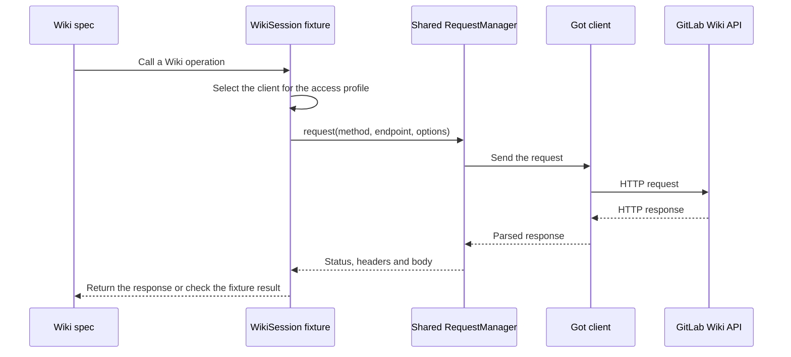

# Lab 4 — Matthew: Project Wiki

[Group lab](l4.md) · [Lab 3 implementation](../l3/l3_matthew.md)

## Activity 1 — Wiki structure

The [Wiki spec](../../../tests/integration/wiki.spec.ts) defines the cases and assertions. The [WikiSession fixture](../../../tests/support/wiki.ts) prepares test data, manages request credentials and tracks pages for cleanup. The [Wiki schemas](../../../src/schemas/wiki.schema.ts) validate response bodies.

## Activity 2 — Singleton request manager

