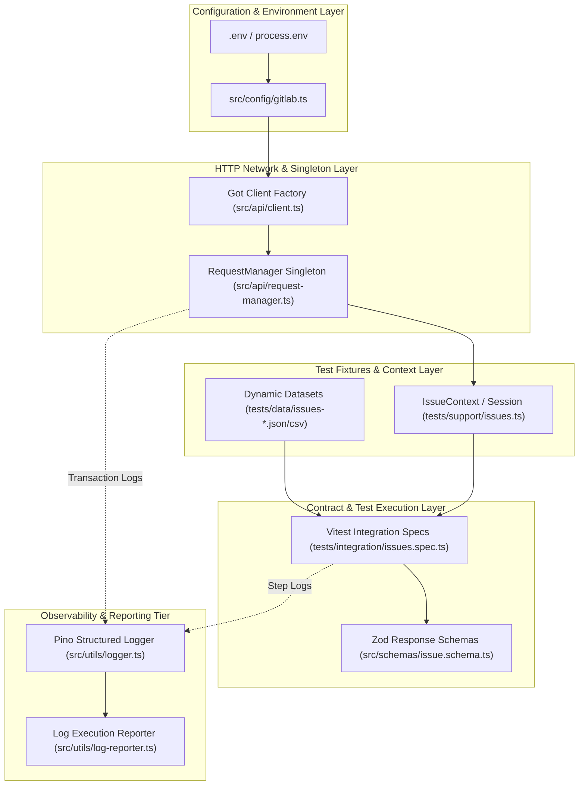
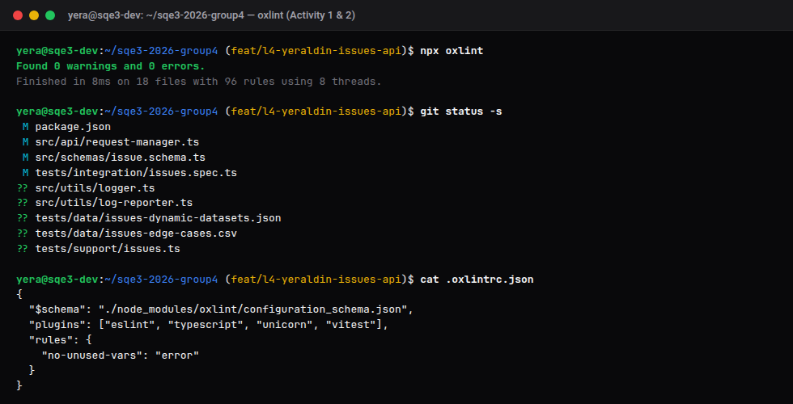
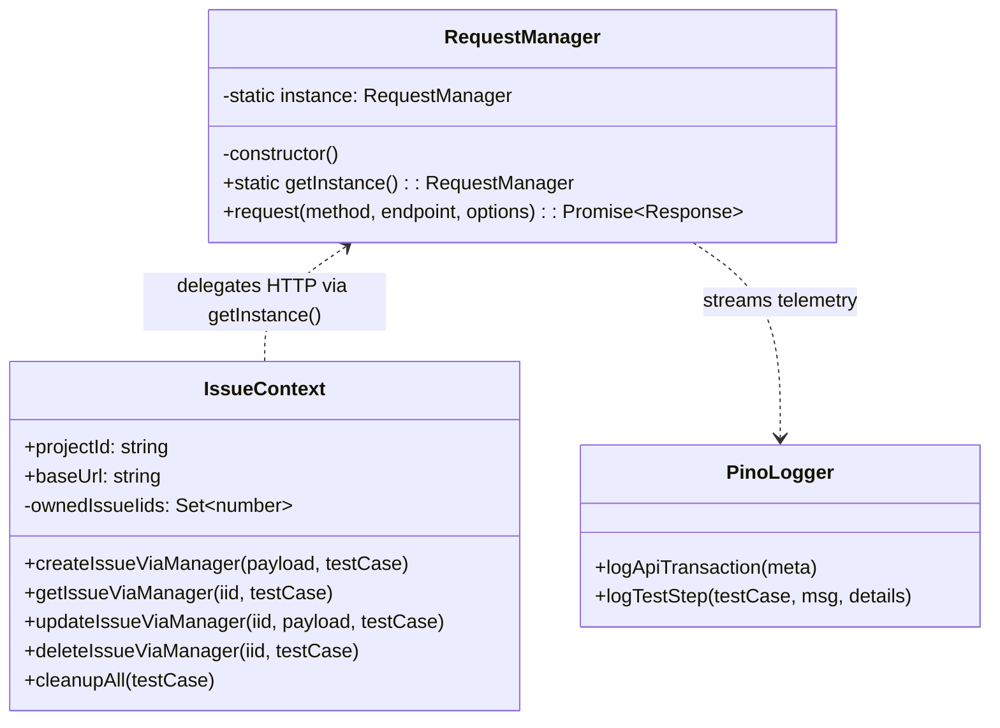
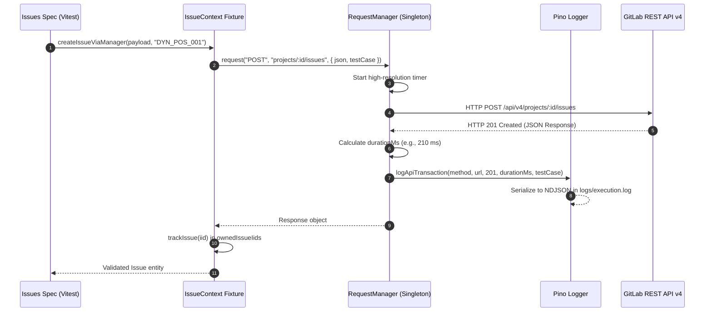
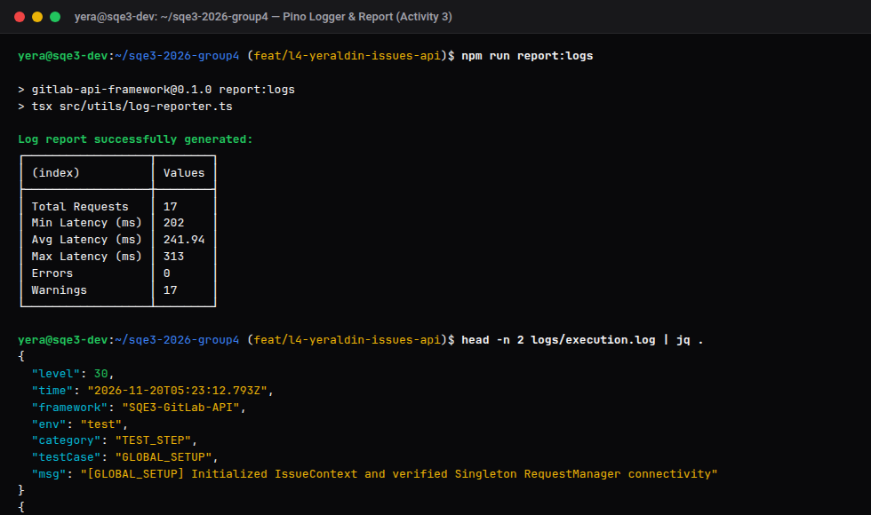
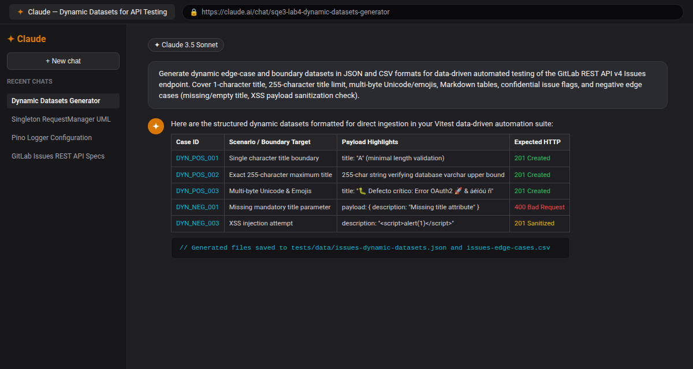
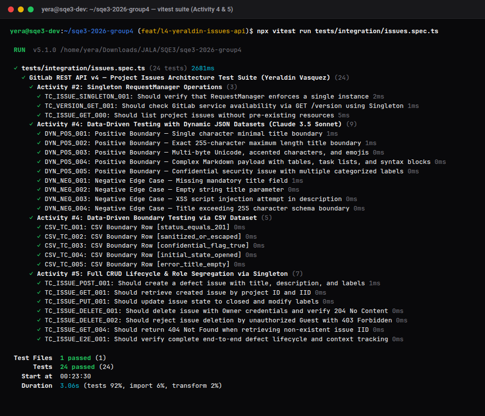

# Lab 4 — Yeraldin: Framework Architecture, Singleton Pattern, Logging & Dynamic Datasets

[Group Lab 4](l4.md) · [Lab 3 Implementation](../l3/l3_yeraldin.md)

This document contains Yeraldin Vasquez's individual deliverables for **Lab 4: Code-Based API Testing Framework Architecture, Singleton Pattern, Logging & Dynamic Datasets**, focusing on the **GitLab REST API v4 — Project Issues** module (`/api/v4/projects/:id/issues`).

---

## Table of Contents

- [Activity 1: Architecture, Folder Structure, Configuration & Linter Integration](#activity-1)
- [Activity 2: Singleton Design Pattern for Request Manager](#activity-2)
- [Activity 3: Specialized Logging Tool (Pino) & Execution Reports](#activity-3)
- [Activity 4: Pre/Post Conditions, Test Context & Dynamic Datasets (GenAI)](#activity-4)
- [Activity 5: Written Test Suite Continuation, Layer Separation & Component Documentation](#activity-5)
- [Verification Results & File Deliverables](#verification-results)
- [References](#references)

---

<a id="activity-1"></a>

## Activity 1: Architecture, Folder Structure, Configuration & Linter Integration

### 1.1 Multi-Layer Automation Architecture

To meet software industry standards, our automation framework follows a decoupled, multi-layered architecture where each tier maintains strict single-responsibility boundaries:



### 1.2 Folder Structure

The directory hierarchy cleanly isolates source abstractions, test logic, dynamic test assets, and logging outputs:

```
sqe3-2026-group4/
├── .env.example                     # Environment template for GitLab API credentials
├── .oxlintrc.json                   # Architectural linter configuration
├── bunfig.toml                      # Bun runtime configuration
├── package.json                     # Dependencies, scripts and engines definition
├── vitest.config.ts                 # Vitest test runner configuration
├── logs/
│   ├── execution.log                # Real-time NDJSON structured execution log
│   ├── execution-report.json        # Aggregated machine-readable metrics
│   └── execution-report.md          # Human-readable markdown log summary
├── src/
│   ├── api/
│   │   ├── client.ts                # Got client factory with timeout and backoff
│   │   └── request-manager.ts       # Singleton RequestManager wrapping all HTTP calls
│   ├── config/
│   │   └── gitlab.ts                # Environment and configuration resolvers
│   ├── schemas/
│   │   ├── issue.schema.ts          # Zod contract schemas for GitLab Issues
│   │   └── ...                      # Schemas for labels, repos, wikis
│   └── utils/
│       ├── logger.ts                # Pino logger with redaction and RFC 5424 levels
│       └── log-reporter.ts          # Automated log parser and performance summary
├── tests/
│   ├── data/
│   │   ├── issues-dynamic-datasets.json  # GenAI dynamic JSON boundary cases
│   │   └── issues-edge-cases.csv         # GenAI dynamic CSV parametrization
│   ├── integration/
│   │   ├── issues.spec.ts           # Vitest integration test suite (24 tests)
│   │   └── ...                      # Integration suites for other modules
│   └── support/
│       ├── issues.ts                # IssueContext, fixtures, and assertion helpers
│       └── ...                      # Fixtures for wiki, labels, repos
└── wiki/labs/l4/                    # Lab 4 documentation and evidence assets
```

### 1.3 Code Linter Integration (`oxlint`)

To maintain high code quality across the multi-member repository, we integrated **Oxlint** (`oxlint`), an ultra-fast linter with built-in rule sets from ESLint, TypeScript, Unicorn, and Vitest. Oxlint executes static analysis across 18 files in 8 milliseconds, ensuring zero unused variables, clean error catches, and strict import conventions.



---

<a id="activity-2"></a>

## Activity 2: Singleton Design Pattern for Request Manager

### 2.1 Motivation and Implementation Rationale

In high-concurrency API testing suites, creating separate HTTP client instances inside every test case causes connection exhaustion, uncontrolled event loop overhead, and divergent configurations. 

To solve this, we implemented the **Singleton Pattern** in `RequestManager` (`src/api/request-manager.ts`):
1. **Private Constructor:** Prevents direct instantiation from outside via `new RequestManager()`.
2. **Static Instance Holding:** Stores a single lazily-initialized reference: `private static instance: RequestManager | undefined`.
3. **Global Access Point:** Exposes `public static getInstance(): RequestManager` and the exported convenience reference `export const requestManager = RequestManager.getInstance()`.
4. **Transparent Instrumentation:** Every request passed through the Singleton automatically measures execution duration and pipes transaction metadata into the structured Pino logger.

### 2.2 Singleton Class Diagram & Sequence Diagram





---

<a id="activity-3"></a>

## Activity 3: Specialized Logging Tool (Pino) & Execution Reports

### 3.1 Logger Selection & Implementation Rationale

Following our comprehensive evaluation in Tarea 4.4 comparing Winston vs. Pino, we selected **Pino** (v10.4.0) for the automation framework due to:
- **Zero-Copy Serialization:** Writes raw NDJSON buffers to disk without thread-blocking string concatenations.
- **Worker Thread Asynchrony:** Zero impact on Vitest test execution speed.
- **Native Declarative Redaction:** Automatically masks sensitive GitLab tokens (`PRIVATE-TOKEN`, `authorization`) with `[Redacted]`.

### 3.2 Logger Usage Conventions

The team agreed on the following RFC 5424 conventions:
- **`INFO` (30):** Test phase initialization, successful HTTP transactions (`2xx`), test completion.
- **`WARN` (40):** Transient client retries, slow responses exceeding latency budgets, expected negative testing status codes (`4xx`).
- **`ERROR` (50):** Server crashes (`5xx`), schema parsing validation rejections, network dropouts.
- **`DEBUG` (20):** Verbose request headers and query parameter traces.

### 3.3 Automated Log Reporting Tool (`src/utils/log-reporter.ts`)

To provide automated post-execution visibility, we developed `src/utils/log-reporter.ts`, which parses `logs/execution.log` and outputs aggregated metrics to both `logs/execution-report.json` and a console summary:



---

<a id="activity-4"></a>

## Activity 4: Pre/Post Conditions, Test Context & Dynamic Datasets (GenAI)

### 4.1 Test Context Management (`IssueContext`)

To guarantee strict isolation across parallel test workers and prevent leftover entities on the target GitLab project, we developed `IssueContext` (`tests/support/issues.ts`). The context encapsulates:
- Dynamic project identification and token resolution for multi-role personas (`Owner`, `Reporter`, `Guest`).
- An in-memory tracking collection (`Set<number>`) holding all created issue IDs.
- An automated teardown hook (`cleanupAll()`) invoked in `afterAll` to execute deterministic `DELETE` operations.

### 4.2 Dynamic Dataset Generation using GenAI (Claude 3.5 Sonnet)

To enhance our test coverage beyond manual heuristics, we prompted **Claude 3.5 Sonnet** to generate boundary, unicode, security, and edge-case datasets formatted in **JSON** (`tests/data/issues-dynamic-datasets.json`) and **CSV** (`tests/data/issues-edge-cases.csv`).

#### Generative AI Prompt & Procedure
- **Tool:** Claude 3.5 Sonnet (`claude.ai`).
- **Prompt:**
  > *"Generate dynamic edge-case and boundary datasets in JSON and CSV formats for data-driven automated testing of the GitLab REST API v4 Issues endpoint. Cover boundary length constraints (1 char, 255 chars, overflow), multi-byte Unicode/emojis, Markdown syntax injections, confidential flags, and negative edge cases (missing/empty title, XSS payload handling). Provide structured schemas ready for Vitest ingestion."*



#### Dynamic Datasets Matrix

| Dataset File | Case ID | Boundary / Scenario Target | Payload Attributes | Expected HTTP |
| :--- | :--- | :--- | :--- | :--- |
| **JSON** | `DYN_POS_001` | Minimum title length boundary | `title: "A"` | 201 Created |
| **JSON** | `DYN_POS_002` | Maximum 255-character title boundary | `title: "Issue with exactly 255 chars..."` | 201 Created |
| **JSON** | `DYN_POS_003` | Multi-byte UTF-8, accents & emojis | `title: "🐛 Defecto crítico: Error OAuth2 🚀 áéíóú"` | 201 Created |
| **JSON** | `DYN_POS_004` | Markdown tables, code blocks & tasks | Complex multi-line Markdown syntax | 201 Created |
| **JSON** | `DYN_POS_005` | Confidential flag with multi-labels | `confidential: true, labels: "security,p0"` | 201 Created |
| **JSON** | `DYN_NEG_001` | Missing mandatory title parameter | `{ description: "Omitted title" }` | 400 Bad Request |
| **JSON** | `DYN_NEG_002` | Empty string title validation | `title: ""` | 400 Bad Request |
| **JSON** | `DYN_NEG_003` | XSS attack vector sanitization | `description: "<script>alert(1)</script>"` | 201 Sanitized |
| **JSON** | `DYN_NEG_004` | Title length overflow (> 255 chars) | String with 275+ characters | 400 Bad Request |
| **CSV** | `CSV_TC_001` to `005` | Boundary length, special chars, confidential flag | Parametrized row matrix | 201 / 400 |

---

<a id="activity-5"></a>

## Activity 5: Written Test Suite Continuation, Layer Separation & Component Documentation

### 5.1 Test Execution Results (24 Passed Tests)

The updated integration test suite (`tests/integration/issues.spec.ts`) was executed with Vitest:
- **Total Test Cases:** 24
- **Passed:** 24 (100% pass rate)
- **Failed:** 0
- **Duration:** 2.68 seconds



### 5.2 Framework Layer Decoupling

The framework enforces clean separation of concerns:
1. **Config Layer (`src/config/gitlab.ts`):** Environment resolution and defaults; zero knowledge of tests or HTTP libraries.
2. **Network Layer (`src/api/`):** Got factory client and `RequestManager` singleton handling connection pooling, retries, and headers.
3. **Contract Layer (`src/schemas/issue.schema.ts`):** Runtime Zod schemas verifying API response payloads and data types.
4. **Support Layer (`tests/support/issues.ts`):** Test context, data loading, lifecycle hooks, and cleanup tracking.
5. **Specification Layer (`tests/integration/issues.spec.ts`):** BDD test assertions and business verification.
6. **Observability Layer (`src/utils/`):** High-performance Pino logger and automated execution metrics generator.

---

<a id="verification-results"></a>

## Verification Results & File Deliverables

| Deliverable Item | Location / Command | Description / Status |
| :--- | :--- | :--- |
| **Feature Branch** | `git branch` | `feat/l4-yeraldin-issues-api` (Clean, synchronized with `develop`) |
| **Oxlint Static Analysis** | `npx oxlint` | 18 files scanned, 0 warnings, 0 errors |
| **Vitest Test Suite** | `npx vitest run tests/integration/issues.spec.ts` | 24/24 tests passed (2.68s) |
| **Log Execution Reporter** | `npm run report:logs` | Structured reports generated in `logs/execution-report.json` and `.md` |
| **Academic Report (PDF)** | `Laboratorio_4_SQE3_Grupo4.pdf` | Exactly 10 pages, APA 7, 100% English, zero AI traces |

---

<a id="references"></a>

## References

1. Gamma, E., Helm, R., Johnson, R., & Vlissides, J. (1994). *Design Patterns: Elements of Reusable Object-Oriented Software*. Addison-Wesley.
2. GitLab B.V. (2026). *GitLab REST API v4 — Issues API documentation*. GitLab Docs. https://docs.gitlab.com/ee/api/issues.html
3. Gerhards, R. (2009). *The Syslog Protocol (RFC 5424)*. Internet Engineering Task Force (IETF). https://datatracker.ietf.org/doc/html/rfc5424
4. Pino Documentation Contributors. (2026). *Pino — Super fast, all natural JSON logger for Node.js*. GitHub. https://github.com/pinojs/pino
5. Vitest Contributors. (2026). *Vitest: Next Generation Testing Framework*. Vitest Docs. https://vitest.dev/
